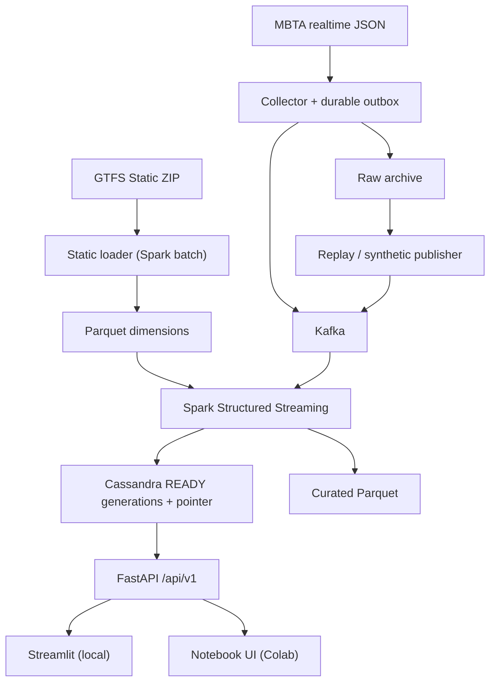

# TransitPulse MBTA

<!-- colab-badge:start -->
[](https://colab.research.google.com/github/nqMinh-GR/de_btl/blob/main/notebooks/TransitPulse_MBTA_Colab_Demo.ipynb)
<!-- colab-badge:end -->

Mở notebook trên Colab:
[TransitPulse_MBTA_Colab_Demo.ipynb](https://colab.research.google.com/github/nqMinh-GR/de_btl/blob/main/notebooks/TransitPulse_MBTA_Colab_Demo.ipynb).

**TransitPulse — MBTA Real-Time Public Transport Monitoring and Predicted Delay Alerts.** Đây là đồ án môn
Data Management & Data Processing. Hệ thống thu thập dữ liệu xe buýt MBTA (Boston), xử lý qua **Kafka → Spark
Structured Streaming → Cassandra**, rồi phục vụ qua **FastAPI** cho dashboard Streamlit (local) và giao diện
notebook (Google Colab). Trọng tâm của dự án là dữ liệu đúng, có phiên bản, có kiểm soát chất lượng và có thể
phục hồi; giao diện chỉ là nơi người dùng xem kết quả đã xử lý.

Tài liệu đặc tả gốc nằm cùng thư mục:
[`system design full.pdf`](system%20design%20full.pdf) (thiết kế hệ thống) và
[`TransitPulse_MBTA_Full_Build_Prompt_GitHub_Colab_VI.md`](TransitPulse_MBTA_Full_Build_Prompt_GitHub_Colab_VI.md) (yêu cầu xây dựng).

## Trạng thái kiểm chứng (đọc trước)

Mã nguồn được viết **mà không chạy bất kỳ lệnh nào** trên máy phát triển, theo yêu cầu. Vì vậy, tại thời điểm
bàn giao:

| Hạng mục | Trạng thái |
|---|---|
| Unit tests, Spark tests | NOT_RUN |
| Native full-stack (Kafka + Spark + Cassandra + API) trên Linux | NOT_RUN |
| Docker Compose (profile `local-docker`) | NOT_RUN — máy build không có quyền Docker daemon |
| Managed Google Colab Run All | NOT_VERIFIED — lần chạy đầu tiên sẽ là trên Colab |
| Live MBTA capture / replay recording thật | NOT_RUN — chưa có recording trong repository |
| Golden smoke (synthetic) | NOT_RUN |
| Benchmark | Chưa đo — các con số trong tài liệu là **mục tiêu**, không phải kết quả |
| `uv.lock` | Chưa có — được sinh ở lần bootstrap đầu tiên trên Colab |

Lần đầu chạy trên Colab có thể gặp lỗi. Mỗi cell của notebook dừng lại khi gặp lỗi và in mã lỗi, gợi ý và đoạn
log để sửa. `reports/environment_verification.json` ghi trạng thái từng hạng mục và chỉ đổi sang PASS khi có
bằng chứng.

## Kiến trúc



* **Nguồn dữ liệu, chỉ dùng MBTA:**
  * GTFS Static: https://cdn.mbta.com/MBTA_GTFS.zip
  * Vehicle Positions: https://cdn.mbta.com/realtime/VehiclePositions.json
  * Trip Updates: https://cdn.mbta.com/realtime/TripUpdates.json
  * Service Alerts: https://cdn.mbta.com/realtime/Alerts.json
  * Dữ liệu thuộc Massachusetts Bay Transportation Authority. Hãy xem điều kiện sử dụng của MBTA trước khi phân
    phối recording.
* **Phạm vi MVP:**
  * 5 tuyến bus (`route_type=3`), được xác minh từ GTFS và một mẫu realtime.
  * Mỗi run dùng một GTFS version bất biến.
  * Có ba chế độ chạy: `live`, `replay` và `synthetic`.
* **Bảo đảm xử lý:** at-least-once, ghi và publish idempotent. API chỉ đọc các generation đã `READY` qua con trỏ
  CAS (`docs/publish_protocol.md`).
* **Chỉ số:**
  * Số xe có vị trí mới (tuổi ≤ 120 s): là số vehicle ID có quan sát hợp lệ, **không** phải số xe MBTA đang chạy.
  * **Độ trễ dự kiến:** mỗi chuyến tính một target stop, ngưỡng 300 s. Có tử số và mẫu số; nếu mẫu số bằng 0
    thì giá trị là `null`. Đây không phải độ trễ thực tế hay chỉ số on-time chính thức của MBTA.

| Thành phần | Công nghệ (phiên bản pin) |
|---|---|
| Python core | 3.11.17 (uv 0.12.23) |
| Java | Temurin JDK 17.0.20.1+1 |
| Stream processing | PySpark / Spark 3.5.7 (Scala 2.12) + `spark-sql-kafka-0-10_2.12:3.5.7` |
| Message broker | Apache Kafka 4.2.2 (KRaft, 1 node) |
| Serving database | Apache Cassandra 5.0.9 (1 node, RF1) |
| API | FastAPI 0.142.2, Pydantic 2.13.5, uvicorn 0.54.0 |
| UI | Notebook widgets (Colab), Streamlit 1.65.0 + PyDeck 0.9.3 (local) |

## Quickstart A — Google Colab: chỉ cần Run All (khuyến nghị)

Làm **một lần** trên máy local:
1. Push repository lên GitHub dưới dạng public. Xem `docs/github_colab.md`.
2. Chạy `python3 scripts/configure_repository.py --repo-url https://github.com/<OWNER>/<REPO>.git` để ghi URL vào
   badge và notebook, rồi commit và push. Script chỉ dùng thư viện chuẩn, không cần `.venv`.

Sau đó, mỗi lần demo:
1. Bấm badge **Open in Colab** ở đầu trang.
2. Chọn **Runtime → Run all**. Không cần sửa gì: mặc định là `DEMO_MODE = "synthetic"` và
   `ENABLE_CLOUDFLARE_TUNNEL = True`. Notebook sẽ lần lượt:
   * clone đúng commit;
   * bootstrap: tải uv, Python 3.11, JDK 17, Kafka, Cassandra, PySpark, connector và `cloudflared`, mất khoảng
     10–15 phút ở lần đầu;
   * khởi động Kafka và Cassandra;
   * chạy golden smoke;
   * bắt đầu session;
   * hiển thị giao diện 5 tab trong notebook;
   * mở **dashboard web qua Cloudflare Tunnel** và in ra link công khai `https://….trycloudflare.com`. Bấm link
     để dùng dashboard Streamlit trên trình duyệt; DNS có thể mất tới khoảng một phút.
3. Cell 17 xuất evidence ZIP. Nếu `uv.lock` được sinh trên Colab, hãy commit file này vào repository.
4. Cell 18 (hoặc nút Stop) dừng đúng các tiến trình của dự án và giữ nguyên dữ liệu. Tunnel có nút tắt riêng.

Ở lần Run All đầu tiên, Colab hiện hộp thoại một lần "Notebook này không do Google tạo". Chọn **Run anyway**.
Nếu bỏ qua bước 2, notebook sẽ hỏi URL repo đúng một lần trong lúc Run All.

Notebook ghi lại kết quả các bước kiểm thử (unit tests, golden smoke). Khi một bước **FAIL**, notebook hiện cảnh báo
màu đỏ rồi vẫn chạy tiếp để demo và link vẫn có. Đặt `STRICT_RUN_ALL = True` nếu muốn Run All dừng ở cuối khi có
bước FAIL.

> **Lưu ý bảo mật:** link Cloudflare quick tunnel là công khai, không có đăng nhập. Ai có link đều xem được
> dashboard trong lúc session chạy. Dashboard chỉ đọc và dữ liệu là dữ liệu công khai của MBTA hoặc dữ liệu
> synthetic. Đặt `ENABLE_CLOUDFLARE_TUNNEL = False` nếu không muốn mở ra Internet; giao diện trong notebook
> vẫn dùng được.

Chế độ khác: `DEMO_MODE="live"` với `ROUTE_IDS` là 5 tuyến bus đã xác minh, hoặc `DEMO_MODE="replay"` với
`RECORDING_MANIFEST` trỏ tới một recording có sẵn. Notebook không tự đổi chế độ khi nguồn lỗi.

## Quickstart B — Linux local, native (cùng code path với Colab)

```bash
export TP_WORKDIR="$PWD/.runtime"
bash scripts/bootstrap_colab.sh --workdir "$TP_WORKDIR" --profile local-native
.venv/bin/python scripts/doctor.py --profile local-native --workdir "$TP_WORKDIR"
.venv/bin/python scripts/infra.py start --profile local-native --workdir "$TP_WORKDIR"
.venv/bin/python scripts/infra.py init  --profile local-native --workdir "$TP_WORKDIR"
.venv/bin/python scripts/demo.py start --profile local-native --mode synthetic --seed 42 \
    --duration-seconds 600 --detach --workdir "$TP_WORKDIR"
.venv/bin/python scripts/demo.py status --profile local-native --workdir "$TP_WORKDIR"
.venv/bin/streamlit run app/streamlit_app.py --server.address 127.0.0.1 --server.port 8501   # cần extra "dashboard"
.venv/bin/python scripts/demo.py stop --all --profile local-native --workdir "$TP_WORKDIR"
```
Lệnh tương đương qua Makefile: `make doctor`, `make infra-up`, `make init`, `make source-check`, `make list-routes`,
`make static-load ROUTE_IDS=...`, `make start-live ROUTE_IDS=... DURATION_SECONDS=7200`, `make start-replay
RECORDING=... SPEED=10`, `make app-up`, `make test`, `make test-integration`, `make benchmark SCENARIO=...`,
`make report RUN_ID=...` và `make stop`. Chạy `make help` để xem toàn bộ.

Profile `local-docker` (`docker-compose.yml`) đã được viết đầy đủ nhưng **chưa chạy thử**.

## Kiểm thử

| Lệnh | Phạm vi |
|---|---|
| `.venv/bin/python -m pytest tests/unit -m unit` | Python thuần: IDs, lịch GTFS/DST, calendar, scope, outbox, API (fake repository), oracle |
| `.venv/bin/python -m pytest tests/runtime -m runtime` | Logic native runner không khởi động dịch vụ: checksum, giải nén an toàn, supervisor/registry, reset, doctor, export |
| `.venv/bin/python -m pytest tests/spark -m spark` | Biến đổi Spark trên golden fixture: freshness, KPI, alerts, so khớp ID giữa Python và Spark (đây là vector đơn vị, **không** phải bằng chứng IT) |
| `.venv/bin/python -m pytest -m integration` | IT01–IT16, chạy với Kafka/Cassandra/Spark thật qua native runner |
| `.venv/bin/python scripts/demo.py golden-smoke` | Golden fixture end-to-end qua API, đối chiếu với `tests/fixtures/golden/expected.json` |

Golden fixture (synthetic, **không phải dữ liệu MBTA**), kỳ vọng ở bước S1:
* Xe: fresh 1, stale 1, unknown 1.
* Dự báo: 2 chuyến đủ điều kiện, 1 chuyến trễ dự kiến, tỷ lệ 0,5, trung bình 210 s.

Oracle độc lập nằm ở `tests/oracle/` và chỉ dùng thư viện chuẩn.

## Cấu trúc repository

| Đường dẫn | Nội dung |
|---|---|
| `src/transitpulse/contracts/` | Envelope, enums, quality reasons, IDs, control events, policy |
| `src/transitpulse/static/` | GTFS loader (Spark batch), lịch, schedule resolver, scope index |
| `src/transitpulse/ingestion/` | Collector HTTP, raw archive, outbox SQLite, Kafka producer, source-check |
| `src/transitpulse/replay/` | Replay publisher, clock control, synthetic/golden/stress generator |
| `src/transitpulse/processing/` | Spark streaming job, generation/pointer protocol, KPI, alerts, batch report |
| `src/transitpulse/storage/` | Cassandra session, migrations, pointer/manifest LWT, static catalog |
| `src/transitpulse/api/` | FastAPI `/api/v1` |
| `src/transitpulse/runtime/` | Native runner: bootstrap, supervisor, Kafka/Cassandra native, CLI demo/infra/export |
| `app/` | Streamlit + PyDeck |
| `notebooks/` | Notebook Colab và `colab_ui.py` (frontend chỉ gọi HTTP) |
| `scripts/` | `bootstrap_colab.sh`, `doctor.py`, `infra.py`, `demo.py`, `export_artifacts.py`, … |
| `config/` | `base.yaml` và các override `local.yaml` / `colab.yaml` / `docker.yaml` |
| `deploy/` | `runtime-manifest.json` (artifacts pin), template cấu hình native |
| `tests/` | unit, spark, integration, runtime, golden fixture, oracle |
| `benchmarks/` | Harness benchmark (không bao giờ tự điền số) |
| `docs/` | Kiến trúc, nghiệp vụ, data dictionary, query mapping, publish protocol, clock, decisions, runbook, demo script, limitations, traceability |

## Tài liệu

* Nghiệp vụ và yêu cầu: `docs/business_requirements.md`
* Kiến trúc và luồng dữ liệu: `docs/architecture.md`
* Từ điển dữ liệu: `docs/data_dictionary.md`
* Ánh xạ query → bảng: `docs/query_mapping.md`
* Giao thức publish và phục hồi: `docs/publish_protocol.md`
* Đồng hồ và lịch GTFS: `docs/clock_and_time.md`
* Quyết định thiết kế: `docs/decisions.md`
* Phiên bản: `docs/versions.md`
* Interfaces giữa các module: `docs/interfaces.md`
* Vận hành và sự cố: `docs/runbook.md`
* Kịch bản demo 10 phút: `docs/demo_script.md`
* GitHub → Colab: `docs/github_colab.md`
* Offline: `docs/offline_checklist.md`
* Giới hạn: `docs/limitations.md`
* Truy vết yêu cầu: `docs/traceability.md`

## Giới hạn chính

Hệ thống có những giới hạn sau:
* Kafka và Cassandra chạy một node, RF1, không có high availability.
* Không có exactly-once xuyên Kafka, Parquet và Cassandra.
* Không có mô hình ETA riêng và không có ground truth để đánh giá độ chính xác của ETA.
* Colab là môi trường demo theo phiên, VM có thể bị thu hồi.
* Demo local không có auth production: các cổng chỉ bind `127.0.0.1`.

Danh sách đầy đủ: `docs/limitations.md`.
