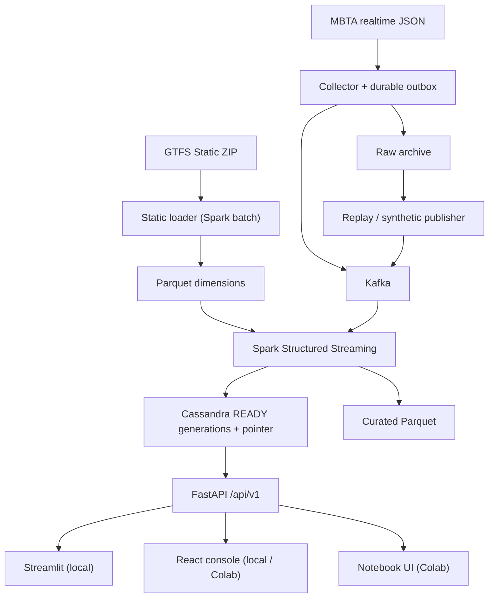

# TransitPulse MBTA

<!-- colab-badge:start -->
[](https://colab.research.google.com/github/nqMinh-GR/de_btl/blob/main/notebooks/TransitPulse_MBTA_Colab_Demo.ipynb)
<!-- colab-badge:end -->

Mở notebook trên Colab:
[TransitPulse_MBTA_Colab_Demo.ipynb](https://colab.research.google.com/github/nqMinh-GR/de_btl/blob/main/notebooks/TransitPulse_MBTA_Colab_Demo.ipynb).

**TransitPulse — MBTA Real-Time Public Transport Monitoring and Predicted Delay Alerts.** Đây là đồ án môn
Data Management & Data Processing. Hệ thống thu thập dữ liệu xe buýt MBTA (Boston), xử lý qua **Kafka → Spark
Structured Streaming → Cassandra**, rồi phục vụ qua **FastAPI** cho console React, dashboard Streamlit (local)
và giao diện notebook (Google Colab). Trọng tâm của dự án là dữ liệu đúng, có phiên bản, có kiểm soát chất lượng và có thể
phục hồi; giao diện chỉ là nơi người dùng xem kết quả đã xử lý.

## Đã chạy end-to-end trên Google Colab

Pipeline native đã chạy trọn trên một VM Colab high-RAM (khoảng 51 GB): bootstrap, Kafka, Cassandra, Spark,
collector live, FastAPI, giao diện notebook và console React. Demo mặc định là **live**, phạm vi **10 tuyến bus**
MBTA (`1`, `15`, `22`, `23`, `28`, `32`, `39`, `57`, `66`, `77`).

| Hạng mục | Kết quả |
|---|---|
| Bootstrap native (Python 3.11.17, JDK 17, Kafka 4.2.2, Cassandra 5.0.9, PySpark 3.5.7) | Chạy xong trên Colab |
| Kafka + Cassandra + Spark driver 16g (profile `colab-native`) | Sẵn sàng; collector poll MBTA mỗi 30 giây |
| Session live, API `/api/v1`, UI notebook 5 tab | Chạy; tab Bản đồ tự lấy vị trí xe mỗi 5 giây |
| Lineage (`demo.py lineage`) | Truy được manifest → Kafka → batch → API |
| Console React qua Cloudflare Tunnel | Link `https://….trycloudflare.com` mở được khi session còn chạy |
| Golden smoke, unit/Spark tests | Có trong notebook (`RUN_GOLDEN_SMOKE`, `RUN_UNIT_TESTS`); số đo benchmark vẫn là mục tiêu, chưa phải SLA |
| Docker Compose (`local-docker`) | Đã viết; đường chạy đã kiểm là native trên Colab, không phải Docker |

## Kiến trúc



* **Nguồn dữ liệu, chỉ dùng MBTA:**
  * GTFS Static: https://cdn.mbta.com/MBTA_GTFS.zip
  * Vehicle Positions: https://cdn.mbta.com/realtime/VehiclePositions.json
  * Trip Updates: https://cdn.mbta.com/realtime/TripUpdates.json
  * Service Alerts: https://cdn.mbta.com/realtime/Alerts.json
  * Dữ liệu thuộc Massachusetts Bay Transportation Authority. Hãy xem điều kiện sử dụng của MBTA trước khi phân
    phối recording.
* **Phạm vi demo đã chạy:**
  * 10 tuyến bus (`route_type=3`) đã có trong GTFS MBTA: `1`, `15`, `22`, `23`, `28`, `32`, `39`, `57`, `66`, `77`.
  * Mỗi run dùng một GTFS version bất biến.
  * Có ba chế độ chạy: `live` (mặc định của notebook), `replay` và `synthetic`.
* **Bảo đảm xử lý:** at-least-once, ghi và publish idempotent. API chỉ đọc các generation đã `READY` qua con trỏ
  CAS (`docs/publish_protocol.md`).
* **Chỉ số:**
  * Số xe có vị trí mới (tuổi ≤ 120 s): là số vehicle ID có quan sát hợp lệ, **không** phải số xe MBTA đang chạy.
  * **Độ trễ dự kiến:** mỗi chuyến tính một target stop, ngưỡng 300 s. Có tử số và mẫu số; nếu mẫu số bằng 0
    thì giá trị là `null`. Đây không phải độ trễ thực tế hay chỉ số on-time chính thức của MBTA.

| Thành phần | Công nghệ (phiên bản pin) |
|---|---|
| Python core | 3.11.17 (uv 0.12.23) |
| Java | Temurin JDK 17.0.20.1+1 |
| Stream processing | PySpark / Spark 3.5.7 (Scala 2.12) + `spark-sql-kafka-0-10_2.12:3.5.7` |
| Message broker | Apache Kafka 4.2.2 (KRaft, 1 node) |
| Serving database | Apache Cassandra 5.0.9 (1 node, RF1) |
| API | FastAPI 0.142.2, Pydantic 2.13.5, uvicorn 0.54.0 |
| UI | Console React + MapLibre (local và link Colab), notebook widgets (Colab), Streamlit 1.65.0 + PyDeck 0.9.3 |

## Quickstart A — Google Colab: Run All (đã chạy xong trên VM high-RAM)

Repository public: https://github.com/nqMinh-GR/de_btl. Badge ở đầu trang mở đúng notebook trên `main`.

Mỗi lần demo:
1. Bấm badge **Open in Colab**. Chọn runtime high-RAM. **Runtime → Run all**.
2. Notebook mặc định `DEMO_MODE = "live"`, `REFRESH_REF = True`, `ENABLE_CLOUDFLARE_TUNNEL = True`,
   `TUNNEL_TARGET = "react"`, và 10 `ROUTE_IDS` ở trên. Nó lần lượt:
   * fetch và checkout `main`;
   * bootstrap (lần đầu khoảng 10–15 phút; lần sau dùng cache);
   * khởi động Kafka (heap 1g) và Cassandra (heap 4G, direct 2G);
   * chạy golden smoke và unit tests nếu hai cờ đó còn `True`;
   * start session live, đợi generation READY và API;
   * hiện 5 tab, tab Bản đồ tự cập nhật vị trí mỗi 5 giây;
   * in link console React `https://….trycloudflare.com`.
3. Cell export ghi evidence ZIP. Cell Stop dừng tiến trình của dự án và giữ dữ liệu.

Lần đầu Colab hỏi "Notebook này không do Google tạo" — chọn **Run anyway**. `REFRESH_REF = True` cần working
tree sạch và không có session đang chạy; nếu vừa push, mở lại notebook từ GitHub rồi chạy từ cell tham số.

> **Lưu ý bảo mật:** link Cloudflare quick tunnel là công khai, không có đăng nhập. Ai có link đều xem được
> console React trong lúc session chạy. Console chỉ đọc; API nằm trong VM và được trang gọi qua cùng origin.
> Dữ liệu là dữ liệu công khai của MBTA hoặc dữ liệu synthetic. Tile bản đồ do trình duyệt khách tải từ
> OpenStreetMap/CARTO. Đặt `ENABLE_CLOUDFLARE_TUNNEL = False` nếu không muốn mở ra Internet; giao diện trong
> notebook vẫn dùng được.

`DEMO_MODE="replay"` cần `RECORDING_MANIFEST`. `DEMO_MODE="synthetic"` bỏ qua `ROUTE_IDS` và dùng 5 tuyến
fixture `R_A`–`R_E`. Notebook không tự đổi chế độ khi nguồn live lỗi.

## Quickstart B — Linux local, native (cùng code path với Colab)

```bash
export TP_WORKDIR="$PWD/.runtime"
bash scripts/bootstrap_colab.sh --workdir "$TP_WORKDIR" --profile local-native
.venv/bin/python scripts/doctor.py --profile local-native --workdir "$TP_WORKDIR"
.venv/bin/python scripts/infra.py start --profile local-native --workdir "$TP_WORKDIR"
.venv/bin/python scripts/infra.py init  --profile local-native --workdir "$TP_WORKDIR"
.venv/bin/python scripts/demo.py start --profile local-native --mode synthetic --seed 42 \
    --duration-seconds 600 --detach --workdir "$TP_WORKDIR"
.venv/bin/python scripts/demo.py status --profile local-native --workdir "$TP_WORKDIR"
.venv/bin/streamlit run app/streamlit_app.py --server.address 127.0.0.1 --server.port 8501   # cần extra "dashboard"
make react-dev   # console React tại http://127.0.0.1:3000, proxy /api tới FastAPI :8000
.venv/bin/python scripts/demo.py stop --all --profile local-native --workdir "$TP_WORKDIR"
```
Lệnh tương đương qua Makefile: `make doctor`, `make infra-up`, `make init`, `make source-check`, `make list-routes`,
`make static-load ROUTE_IDS=...`, `make start-live ROUTE_IDS=... DURATION_SECONDS=7200`, `make start-replay
RECORDING=... SPEED=10`, `make app-up`, `make test`, `make test-integration`, `make benchmark SCENARIO=...`,
`make report RUN_ID=...` và `make stop`. Chạy `make help` để xem toàn bộ.

Profile `local-docker` (`docker-compose.yml`) đã được viết. Đường đã chạy end-to-end là native trên Colab
(`colab-native`), không phải Docker.

## Kiểm thử

| Lệnh | Phạm vi |
|---|---|
| `.venv/bin/python -m pytest tests/unit -m unit` | Python thuần: IDs, lịch GTFS/DST, calendar, scope, outbox, API (fake repository), oracle |
| `.venv/bin/python -m pytest tests/runtime -m runtime` | Logic native runner không khởi động dịch vụ: checksum, giải nén an toàn, supervisor/registry, reset, doctor, export |
| `.venv/bin/python -m pytest tests/spark -m spark` | Biến đổi Spark trên golden fixture: freshness, KPI, alerts, so khớp ID giữa Python và Spark (đây là vector đơn vị, **không** phải bằng chứng IT) |
| `.venv/bin/python -m pytest -m integration` | IT01–IT16, chạy với Kafka/Cassandra/Spark thật qua native runner |
| `.venv/bin/python scripts/demo.py golden-smoke` | Golden fixture end-to-end qua API, đối chiếu với `tests/fixtures/golden/expected.json` |

Golden fixture (synthetic, **không phải dữ liệu MBTA**), kỳ vọng ở bước S1:
* Xe: fresh 1, stale 1, unknown 1.
* Dự báo: 2 chuyến đủ điều kiện, 1 chuyến trễ dự kiến, tỷ lệ 0,5, trung bình 210 s.

Oracle độc lập nằm ở `tests/oracle/` và chỉ dùng thư viện chuẩn.

## Cấu trúc repository

| Đường dẫn | Nội dung |
|---|---|
| `src/transitpulse/contracts/` | Envelope, enums, quality reasons, IDs, control events, policy |
| `src/transitpulse/static/` | GTFS loader (Spark batch), lịch, schedule resolver, scope index |
| `src/transitpulse/ingestion/` | Collector HTTP, raw archive, outbox SQLite, Kafka producer, source-check |
| `src/transitpulse/replay/` | Replay publisher, clock control, synthetic/golden/stress generator |
| `src/transitpulse/processing/` | Spark streaming job, generation/pointer protocol, KPI, alerts, batch report |
| `src/transitpulse/storage/` | Cassandra session, migrations, pointer/manifest LWT, static catalog |
| `src/transitpulse/api/` | FastAPI `/api/v1` |
| `src/transitpulse/runtime/` | Native runner: bootstrap, supervisor, Kafka/Cassandra native, CLI demo/infra/export |
| `app/` | Streamlit + PyDeck |
| `frontend/` | Console React + MapLibre (chỉ gọi HTTP) |
| `notebooks/` | Notebook Colab và `colab_ui.py` (frontend chỉ gọi HTTP) |
| `scripts/` | `bootstrap_colab.sh`, `doctor.py`, `infra.py`, `demo.py`, `export_artifacts.py`, … |
| `config/` | `base.yaml` và các override `local.yaml` / `colab.yaml` / `docker.yaml` |
| `deploy/` | `runtime-manifest.json` (artifacts pin), template cấu hình native |
| `tests/` | unit, spark, integration, runtime, golden fixture, oracle |
| `benchmarks/` | Harness benchmark (không bao giờ tự điền số) |
| `docs/` | Kiến trúc, nghiệp vụ, data dictionary, query mapping, publish protocol, clock, decisions, runbook, demo script, limitations, traceability |

## Tài liệu

### Tổng hợp dự án và Data Business Requirements

Tài liệu tổng hợp theo phạm vi **10 tuyến bus trong notebook hiện tại**, gồm **8 Data Business Requirements**
và **32 tiêu chí nghiệm thu**: vehicle position, ETA, service alerts, freshness, delay KPI, data quality,
pipeline status và replay/recovery. Mỗi BR có mục tiêu nghiệp vụ, dữ liệu đầu vào, quy tắc xử lý, đầu ra API
và bằng chứng mã nguồn. Tài liệu cũng ghi rõ khác biệt với thiết kế cũ và những phần còn cần kiểm chứng runtime.

* [Đọc bản Markdown](docs/TransitPulse_MBTA_Project_Data_Business_Requirements_VI.md)
* [Tải bản Word](docs/TransitPulse_MBTA_Project_Data_Business_Requirements_VI.docx)

Bộ khảo sát codebase gồm: [công nghệ](docs/codebase/STACK.md), [cấu trúc](docs/codebase/STRUCTURE.md),
[kiến trúc](docs/codebase/ARCHITECTURE.md), [quy ước](docs/codebase/CONVENTIONS.md),
[tích hợp](docs/codebase/INTEGRATIONS.md), [kiểm thử](docs/codebase/TESTING.md)
và [rủi ro cùng khoảng trống](docs/codebase/CONCERNS.md).

### Đặc tả và vận hành

* Nghiệp vụ và yêu cầu: `docs/business_requirements.md`
* Kiến trúc và luồng dữ liệu: `docs/architecture.md`
* Từ điển dữ liệu: `docs/data_dictionary.md`
* Ánh xạ query → bảng: `docs/query_mapping.md`
* Giao thức publish và phục hồi: `docs/publish_protocol.md`
* Đồng hồ và lịch GTFS: `docs/clock_and_time.md`
* Quyết định thiết kế: `docs/decisions.md`
* Phiên bản: `docs/versions.md`
* Interfaces giữa các module: `docs/interfaces.md`
* Vận hành và sự cố: `docs/runbook.md`
* Kịch bản demo 10 phút: `docs/demo_script.md`
* GitHub → Colab: `docs/github_colab.md`
* Offline: `docs/offline_checklist.md`
* Giới hạn: `docs/limitations.md`
* Truy vết yêu cầu: `docs/traceability.md`

## Giới hạn chính

Hệ thống có những giới hạn sau:
* Kafka và Cassandra chạy một node, RF1, không có high availability.
* Không có exactly-once xuyên Kafka, Parquet và Cassandra.
* Không có mô hình ETA riêng và không có ground truth để đánh giá độ chính xác của ETA.
* Colab là môi trường demo theo phiên, VM có thể bị thu hồi.
* Demo local không có auth production: các cổng chỉ bind `127.0.0.1`.

Danh sách đầy đủ: `docs/limitations.md`.
