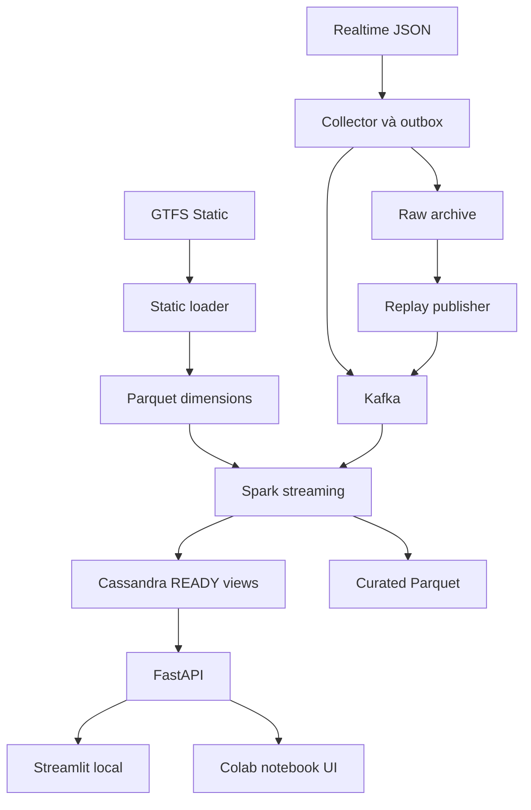

# Prompt hoàn chỉnh xây dựng TransitPulse MBTA với GitHub và Google Colab

Đây là prompt giao cho coding agent để xây dựng dự án, không phải báo cáo về một hệ thống đã chạy. Hãy sao chép toàn bộ nội dung từ mục 0 đến hết để giao cho coding agent. Phiên bản này bổ sung workflow bắt buộc: xây code → push lên GitHub → mở notebook Google Colab → clone đúng commit → dựng dịch vụ → chạy pipeline và demo tương tác. Các thông số tải, độ trễ, retention và ngưỡng cảnh báo bên dưới là lựa chọn thiết kế của project; không phải SLA hay quy định vận hành của MBTA.

## 0. Vai trò và cách làm việc

Bạn là Senior Data Engineer kiêm Backend Engineer. Hãy xây dựng hoàn chỉnh một repository có thể chạy, kiểm thử và demo cho dự án **TransitPulse — MBTA Real-Time Public Transport Monitoring and Predicted Delay Alerts**.

Đây là project môn học về Data Management and Data Processing trong transportation. Trọng tâm là dữ liệu, pipeline xử lý và bằng chứng về tính đúng đắn; giao diện là nơi người dùng sử dụng kết quả.

Mục tiêu bàn giao là một repository GitHub có notebook `notebooks/TransitPulse_MBTA_Colab_Demo.ipynb` đủ các cell để chạy demo trên Google Colab CPU. Colab là môi trường demo theo phiên; không thiết kế nó thành nơi vận hành 24/7. Code nghiệp vụ phải nằm trong package của repository, notebook chỉ điều phối và hiển thị dữ liệu qua API.

Không chỉ đưa ra kiến trúc hoặc pseudocode. Hãy tạo code, cấu hình, schema, fixtures, tests, tài liệu, lệnh chạy và kịch bản demo. Triển khai theo các giai đoạn ở mục 21; hoàn thành một vertical slice trước khi mở rộng. Phải có hai profile: `local-docker` cho máy cá nhân và `colab-native` chạy các tiến trình trực tiếp, không cần Docker daemon hoặc systemd. Chúng dùng chung source code, schema, transformations, API và oracle. Nếu môi trường hiện tại không chạy được full stack hoặc không truy cập Colab, vẫn hoàn thiện code và kiểm thử khả dụng; ghi chính xác phần nào chưa được xác minh. Không dùng mock Kafka/Cassandra để báo full integration PASS.

Quy tắc làm việc:

- Đọc repository và hướng dẫn hiện có trước khi chỉnh sửa; bảo toàn thay đổi của người dùng.
- Xây dựng code trong repository; ưu tiên sớm kiểm tra native runner phù hợp Colab. Chuẩn bị Git, CI và hướng dẫn push. Nếu người dùng đã chỉ định remote và yêu cầu push, dùng quyền Git hiện có; nếu chưa có remote, hoàn tất repository và để biến cấu hình, không dừng việc viết code. Không tự tạo tài nguyên cloud hoặc tài khoản.
- Không yêu cầu API key cho đường dữ liệu chính. Không thay MBTA bằng dữ liệu khác khi gặp lỗi mạng.
- Có thể tạo fixtures tổng hợp để kiểm thử, nhưng phải ghi rõ `source_type=synthetic`; không giả danh dữ liệu thu thập thật.
- Không bịa số benchmark, số xe, thời gian cập nhật hay kết quả test. Mục tiêu hiệu năng phải được phân biệt với kết quả đo.
- Không dùng `latest` cho dependency hoặc Docker image. Kiểm tra và pin một bộ phiên bản tương thích.
- Dùng tên biến, module và endpoint bằng tiếng Anh; viết README và diễn giải kỹ thuật bằng tiếng Việt, có định nghĩa thuật ngữ.
- Với quyết định nhỏ chưa được chỉ định, chọn mặc định hợp lý, ghi trong `docs/decisions.md` và tiếp tục. Chỉ hỏi khi thiếu quyền, có nguy cơ mất dữ liệu hoặc lựa chọn làm thay đổi đáng kể phạm vi.
- Không chạy lệnh xóa volumes/checkpoints/dữ liệu như một phần khởi động thông thường. Reset phải là lệnh riêng, có phạm vi chính xác và xác nhận của người dùng.

## 1. Mục tiêu, phạm vi và sản phẩm đầu ra

### 1.1. Ba phần bắt buộc của môn học

| Phần | Nội dung phải thể hiện trong sản phẩm |
|---|---|
| Business and related data | Người dùng, nhu cầu, bốn nguồn MBTA, hợp đồng dữ liệu và các chỉ số có ý nghĩa |
| Data engineering | Ingestion, quản lý phiên bản lịch trình, Kafka, Spark Structured Streaming, Cassandra, chất lượng dữ liệu, lịch sử và khôi phục |
| Application development | FastAPI và dashboard giúp người dùng xem tuyến, vị trí xe, dự báo đến trạm và cảnh báo |

### 1.2. Phạm vi MVP

Chỉ làm một mạng vận tải: **MBTA**, ưu tiên **5 tuyến bus**, cấu hình mở rộng lên 10 tuyến khi kiểm tra dung lượng và tài nguyên cho phép. Tải danh mục tuyến từ GTFS rồi chọn tuyến bus; không hardcode rằng mọi ID minh họa đều tồn tại.

MVP phải có:

1. Nhập lịch trình, tuyến, trạm và hình học tuyến từ GTFS Static.
2. Đọc ba feed realtime MBTA.
3. Lưu raw snapshot trước khi xử lý để kiểm tra và replay.
4. Vị trí xe theo tuyến, kèm thời điểm quan sát và tình trạng freshness.
5. Dự báo đến/rời trạm và độ lệch dự kiến so với lịch trình khi có đủ dữ liệu.
6. Cảnh báo dịch vụ từ MBTA; cảnh báo chất lượng dữ liệu của hệ thống phải hiển thị riêng.
7. Lịch sử quan sát của một xe và báo cáo phân tích theo thời gian.
8. Demo replay offline sau khi đã chuẩn bị dữ liệu và dependencies.
9. Kiểm thử duplicates, bản cập nhật đến muộn, dữ liệu không hợp lệ, feed trống và restart.
10. Notebook Colab clone repository, bootstrap runtime, chạy Kafka–Spark–Cassandra thật, mở giao diện notebook qua FastAPI và xuất evidence ZIP.
11. Benchmark có cách đo rõ ràng, tách tải nguồn ngoài khỏi tải pipeline nội bộ.

### 1.3. Không thuộc MVP

Không cần huấn luyện ML dự báo ETA, tối ưu tuyến đường, ticketing, dữ liệu hành khách cá nhân, thanh toán, traffic API thương mại, Kubernetes, Airflow, nhiều database bổ sung hay cloud deployment. Không gọi việc xe bus đi chậm là bằng chứng xác định tắc đường. Không tuyên bố đánh giá chính xác ETA nếu chưa có ground truth giờ đến thực tế.

## 2. Người dùng và yêu cầu nghiệp vụ

| Người dùng | Nhu cầu | Kết quả cần thấy |
|---|---|---|
| Hành khách | Xe ở đâu, khi nào đến trạm, tuyến có gián đoạn không | Bản đồ, ETA theo trạm, service alerts |
| Người theo dõi vận hành | Tuyến nào có dự báo chậm, bao nhiêu xe có vị trí mới | Route dashboard và thời điểm tính chỉ số |
| Data engineer | Nguồn còn hoạt động không, dữ liệu lỗi ở đâu, xử lý có backlog không | Data quality, pipeline metrics, raw reference và DLQ |
| Giảng viên | Dữ liệu thực sự đi qua các công nghệ và kết quả có đúng không | Demo end-to-end, test report, benchmark và fault-recovery report |

Các tình huống sử dụng:

- Chọn một tuyến và xem các xe có dữ liệu vị trí trong snapshot hiện tại.
- Click xe để xem `vehicle_id`, tuyến/chuyến, tọa độ, thời điểm quan sát, tuổi dữ liệu và nguồn.
- Chọn trạm để xem các dự báo sắp tới, phân biệt dự báo realtime với thông tin chất lượng thấp hoặc dựa trên lịch.
- Xem tỷ lệ chuyến có độ trễ dự kiến từ 5 phút trở lên trong tập chuyến đủ dữ liệu.
- Xem cảnh báo đang có hiệu lực, sắp có hiệu lực hoặc không xác định được thời hạn.
- Khi feed ngừng cập nhật, giao diện vẫn chạy nhưng phải báo dữ liệu stale, không giữ trạng thái “đang cập nhật” giả.
- Chuyển sang một replay run và biết rõ đồng hồ trên màn hình là thời gian lịch sử.

## 3. Chốt nguồn dữ liệu: chỉ dùng MBTA mục 1

### 3.1. Bốn nguồn bắt buộc

| Nguồn | URL chính | Định dạng |
|---|---|---|
| GTFS Static | [MBTA_GTFS.zip](https://cdn.mbta.com/MBTA_GTFS.zip) | ZIP chứa các bảng text dạng CSV |
| Vehicle Positions | [VehiclePositions.json](https://cdn.mbta.com/realtime/VehiclePositions.json) | JSON |
| Trip Updates | [TripUpdates.json](https://cdn.mbta.com/realtime/TripUpdates.json) | JSON |
| Service Alerts | [Alerts.json](https://cdn.mbta.com/realtime/Alerts.json) | JSON |

Các endpoint lấy từ tài liệu MBTA [S1, S2]. Bắt đầu bằng JSON. Protobuf là adapter tùy chọn, không phải một pipeline khác:

- [VehiclePositions.pb](https://cdn.mbta.com/realtime/VehiclePositions.pb)
- [TripUpdates.pb](https://cdn.mbta.com/realtime/TripUpdates.pb)
- [Alerts.pb](https://cdn.mbta.com/realtime/Alerts.pb)

Không lấy MBTA V3 API, LAMP, MTA hay GTFS Hà Nội làm dependency bắt buộc. Không cần phối hợp nhiều thành phố. Nếu endpoint thay đổi, đối chiếu tài liệu MBTA rồi cập nhật cấu hình và ghi lại, không âm thầm đổi nguồn.

### 3.2. Kiểm tra nguồn trước khi code sâu

Tạo lệnh `source-check` để:

- GET một lần cho từng nguồn, có timeout, kiểm tra status, content type, parse được hay không và kích thước.
- Với realtime, báo `header.timestamp`, `gtfs_realtime_version`, incrementality, số entity, phân bố trường thiếu và số entity thuộc scope.
- Với static, báo các file tồn tại, `feed_version`, khoảng ngày lịch trình và danh mục tuyến bus.
- Lưu báo cáo kiểm tra với `checked_at`; không đưa dữ liệu chưa tải thành công vào mục “đã xác minh”.
- Nếu không có Internet, báo lỗi nguồn, tiếp tục kiểm thử fixture có nhãn đúng; không fabricate response HTTP 200.

Tra cứu điều kiện sử dụng/attribution của nguồn trước khi phân phối một recording lớn. License của repository tài liệu hay code không mặc nhiên là license của mọi dữ liệu feed.

## 4. Công nghệ, phiên bản và hai môi trường chạy

### 4.1. Stack chung

| Thành phần | Công nghệ | Vai trò |
|---|---|---|
| Static loader, collector, replay | Python 3.11 | Thu thập, version dữ liệu, raw/outbox, phát lại |
| Message broker | Apache Kafka KRaft | Vận chuyển snapshots, offsets và control |
| Processing | PySpark Structured Streaming | Parse, validate, join static, dedup, projections và KPI |
| Serving database | Apache Cassandra | Query-oriented views, history, metadata và publish pointer |
| Raw/curated storage | Gzip JSON, ZIP và Parquet | Audit, replay và Spark batch analytics |
| Backend | FastAPI và Pydantic | API chung cho cả hai frontend |
| Frontend local | Streamlit và PyDeck | Dashboard trên máy cá nhân |
| Frontend Colab | Notebook widgets, bảng và lược đồ tọa độ | Demo tương tác ngay trong notebook, gọi FastAPI localhost |
| Orchestration local | Docker Compose | Đóng gói và quản lý services |
| Orchestration Colab | Native process supervisor | Dựng Kafka, Cassandra, Spark, API trực tiếp trong VM |
| Testing | pytest và integration/fault tests | Oracle, correctness, recovery, clean clone và notebook |

Filesystem nhiều lớp ở MVP chưa phải một lakehouse ACID. SQLite chỉ được dùng cho outbox/process metadata nếu cần; không thay Cassandra làm serving database.

### 4.2. Bộ phiên bản tham chiếu và khóa dependencies

Bộ mặc định để bắt đầu triển khai:

| Thành phần | Phiên bản hoặc ràng buộc |
|---|---|
| Python của core pipeline | 3.11; chốt patch trong `.python-version` |
| Java | JDK 17; pin vendor, patch, URL và checksum sau khi xác minh artifact |
| PySpark và Spark runtime | 3.5.7 |
| Scala binary của Spark | 2.12 |
| Spark Kafka connector | `org.apache.spark:spark-sql-kafka-0-10_2.12:3.5.7` cùng toàn bộ dependencies |
| Kafka broker | 4.2.2, KRaft single node |
| Cassandra server | 5.0.9 single node |
| Python Kafka/Cassandra clients | Chọn bản tương thích Python 3.11 và broker/server, kiểm tra rồi lock exact version |
| FastAPI, Pydantic, Streamlit, PyDeck, pytest và các thư viện khác | Lock exact versions trong `uv.lock` sau kiểm tra |
| Notebook kernel | Kiểm tra phiên bản thực tế của Colab; tách dependencies UI khỏi core Python 3.11 |

Các bản Kafka/Cassandra và connector trên có tài liệu/artifacts chính thức [S8, S10–S15], nhưng **chưa được integration-test chung trong yêu cầu này**. Coding agent phải chạy smoke test producer → Spark Kafka reader → Cassandra → API trước khi ghi bộ phiên bản là VERIFIED. Nếu một patch không khả dụng hoặc không tương thích, chọn patch phù hợp, cập nhật đồng bộ manifest, lockfile, Docker/native config và giải thích trong `docs/versions.md`; không cài `latest`.

Kafka binary dùng Scala 2.13 không bắt buộc có cùng Scala binary với Spark: broker chạy trong JVM riêng. **Connector nằm trong Spark classpath phải đúng Scala 2.12 và Spark 3.5.7.**

Core tạo virtual environment riêng. `spark-submit`, `pyspark`, driver và Python workers dùng đúng environment này; không lấy ngẫu nhiên Java/Python của notebook kernel. Cassandra sink dùng Python driver với prepared statements/bounded writes; không bắt buộc thêm Cassandra Spark connector.

Tạo `deploy/runtime-manifest.json` gồm artifact versions, URLs, checksums, Java patch, Python patch, package lock hash, Scala/Spark versions và connector dependencies. Không bịa checksum. Phân biệt manifest đã kiểm chứng với trạng thái chưa tải/chưa test.

### 4.3. Hai profile bắt buộc

| Thuộc tính | `local-docker` | `colab-native` |
|---|---|---|
| Khởi chạy | Docker Compose | Binary distributions và subprocess supervisor |
| Docker/systemd | Docker daemon là prerequisite local | Không là prerequisite |
| Python | Image/environment được pin | Project `.venv` Python 3.11 tách kernel Colab |
| Kafka/Cassandra/Spark | Services local, RF1, Spark local mode | Các tiến trình local trong cùng VM, RF1, Spark `local[2]` |
| Frontend | Streamlit/PyDeck | Notebook gọi FastAPI, Streamlit là tùy chọn |
| Dữ liệu | Volumes local | Work directory local của phiên Colab |
| Triển khai 24/7 | Ngoài MVP | Ngoài mục đích của Colab demo |

Không triển khai một pipeline giản lược riêng cho Colab. Các profile chỉ khác launcher, địa chỉ kết nối, resource budget, root paths và frontend adapter.

### 4.4. Tài nguyên và giới hạn demo

CPU-only, không cần GPU. Máy local tham chiếu: 4 CPU, khoảng 16 GiB RAM. Với Colab, đo CPU, RAM tổng/RAM available và disk trước khi khởi động; không hardcode mọi runtime có cùng tài nguyên.

Budget khởi điểm cho `colab-native`, cần đo RSS thực tế:

- Kafka heap 512 MiB, broker/controller kết hợp, một partition mỗi topic.
- Cassandra heap 1536 MiB, giới hạn off-heap/memtable theo config phiên bản.
- Spark local[2], driver memory khoảng 1–2 GiB, shuffle partitions 2–4 cho scope nhỏ.
- API, collector và notebook dùng phần RAM còn lại; giữ headroom cho hệ điều hành và Python workers.
- Preflight tham chiếu: tối thiểu 2 CPU, khoảng 10 GiB RAM tổng và 8 GiB available, 6 GiB disk trống; khuyến nghị RAM cao hơn cho benchmark. Đây là mục tiêu sizing chưa đo, không phải bảo đảm chạy được.
- Demo scope 5 tuyến; có profile chẩn đoán ít tuyến hơn nếu người dùng chọn. Báo đúng scope giảm, không tính đó là nghiệm thu 5 tuyến.
- Không tự thêm Prometheus/Grafana vào Colab core demo.

Một node/broker và RF1 chưa chứng minh high availability hoặc chịu mất toàn bộ host.

## 5. Kiến trúc và trách nhiệm các thành phần

### 5.1. Các đường dữ liệu

| Đường | Luồng và mục đích |
|---|---|
| Static | MBTA ZIP → raw phiên bản → Spark batch/static validation → Parquet dimensions + Cassandra static tables |
| Realtime | MBTA JSON → raw snapshot + durable outbox → Kafka → Spark Structured Streaming → Cassandra query views + curated history |
| Application | Cassandra query views → FastAPI → Streamlit local hoặc notebook UI trên Colab |
| Replay | Recording + đúng GTFS version → replay publisher → cùng Kafka/processing/API/UI như live |
| Quality | Lỗi parse/validation → raw reference + DLQ + quality report |
| Batch report | Curated observations/predictions → Spark batch dedup + grouping theo thời gian → report files |

### 5.2. Ranh giới trách nhiệm

- Collector chỉ làm transport, lưu raw, lựa chọn scope và đóng envelope; không tính KPI nghiệp vụ thay Spark.
- Spark phải thực sự parse entity, chuẩn hóa, validation, join static và tính các chỉ số. Không chỉ đọc Kafka rồi chuyển nguyên JSON sang database.
- Cassandra lưu query-oriented projections; không cố làm join SQL hoặc analytics toàn lịch sử trong từng request.
- FastAPI đọc kết quả đã xử lý, đánh giá freshness tại thời điểm request và trả metadata; không truy cập MBTA trực tiếp để né pipeline.
- Streamlit và notebook UI chỉ đọc FastAPI; không tự tính lại pipeline từ nguồn MBTA. Cell minh họa lineage có thể đọc raw/offsets để giải thích, nhưng không làm nguồn dữ liệu cho trang ứng dụng.
- Live, replay và synthetic sử dụng cùng business transformations, chỉ khác adapter nguồn, `run_id` và clock mode.

### 5.3. Sơ đồ luồng chung cho hai profile



Dùng sơ đồ này làm cơ sở README/architecture docs. Native và Docker launch cùng pipeline; notebook frontend không tạo một đường đọc bỏ qua Spark/Cassandra.

## 6. Hợp đồng dữ liệu, định danh và đồng hồ

### 6.1. Run isolation

Mỗi lần chạy có `run_id` riêng và một `scope_id` tạo từ danh sách tuyến, cấu hình và GTFS version. Mọi record, checkpoint namespace, output và API request đều xác định run. Không trộn live/replay/synthetic trong cùng một tập KPI.

`source_type` chỉ có: `live`, `replay`, `synthetic`. `clock_mode` là `wall` cho live, `source` cho replay và các scenario lịch sử. Fixture phải ghi cả `fixture_kind`, seed và provenance.

MVP gắn một GTFS version bất biến với mỗi run. Khi đổi static version/scope, mở run mới hoặc một segment mới có định danh rõ ràng; không thay dimensions đang được sử dụng mà không ghi lại.

### 6.2. Snapshot-per-message cho MVP

Chọn **một snapshot đã lọc scope trên một Kafka message** để tránh publish trạng thái nửa snapshot. Raw archive vẫn lưu response gốc đầy đủ. Kích thước envelope sau serialize không được vượt 4 MiB; cấu hình broker/producer/consumer đồng bộ với giới hạn này và có headroom.

Trước khi chốt scope, đo kích thước snapshot đã lọc. Nếu quá giới hạn: lưu raw, ghi `PAYLOAD_TOO_LARGE`, không publish, không cắt entity cho vừa rồi gọi đó là snapshot đầy đủ. Có thể giảm scope công khai trong cấu hình. Chunking có barrier là cải tiến sau MVP, không được triển khai nửa vời.

Envelope tối thiểu gồm:

| Trường | Ý nghĩa |
|---|---|
| `schema_version` | Phiên bản envelope, bắt đầu từ `1` |
| `run_id`, `scope_id`, `source_type` | Định danh và provenance |
| `feed_type` | `vehicle_positions`, `trip_updates`, `alerts` |
| `snapshot_id` | ID logic ổn định khi phát lại cùng snapshot |
| `capture_id` | ID của một lần thu thập thành công; retry publish không tạo ID mới |
| `source_url` | URL gốc, không chứa secret |
| `gtfs_version` | Static version được gắn với run |
| `feed_timestamp` | Timestamp trong feed header, UTC epoch seconds |
| `original_fetched_at` | Thời điểm thu thập bản gốc, UTC |
| `published_at` | Thời điểm enqueue lần phát hiện tại, UTC wall clock |
| `raw_sha256`, `raw_path` | Kiểm tra toàn vẹn và tham chiếu archive |
| `source_entity_count`, `selected_entity_count` | Số entity trước/sau lọc scope |
| `header`, `entities` | Header và các entity gốc trong scope |
| `scenario_id` | Null đối với live bình thường; ghi khi injection |

Canonicalize trước khi hash. `snapshot_id` gồm run/scope/feed, header timestamp và hash nội dung logic đã lọc; không phụ thuộc `published_at`, processing time hay random UUID phát sinh khi retry.

Định nghĩa thêm `observation_id` cho một quan sát xe: hash của định danh xe, descriptor chuyến, timestamp quan sát và nội dung vị trí. Không tạo một observation mới chỉ vì collector tải lại cùng quan sát. `snapshot_id` và `observation_id` giải quyết hai bài toán khác nhau.

Nếu thiếu timestamp quan sát, record chỉ là một `snapshot_state_sample`: ID gồm header timestamp hiệu dụng và payload, với `event_time_origin=feed_header`. Không gọi các sample này là các phép đo GPS độc lập đã xác nhận; mặc định loại chúng khỏi derived-speed và analytics cần event-time chính xác. Khóa history sử dụng chính thời điểm hiệu dụng đã dùng khi tạo ID, không dùng processing time hoặc capture time khiến retry sinh thêm rows.

### 6.3. Các mốc thời gian phải tách biệt

- `observation_time`: thời điểm nguồn đo vị trí xe, nếu có.
- `feed_timestamp`: thời điểm feed được tạo.
- `original_fetched_at`: thời điểm collector gốc lấy response.
- `published_at`: wall clock khi phát message live hoặc replay.
- `processed_at`, `view_published_at`: wall clock của xử lý và publish serving view.
- `application_clock`: thời điểm nghiệp vụ để đánh giá ETA/freshness; UTC hiện tại cho live, clock lịch sử cho replay.

Không lấy timestamp header làm bằng chứng xe vừa được đo nếu entity thiếu timestamp. Có thể dùng header làm thời điểm hiệu dụng để lưu/sắp xếp, nhưng phải ghi `event_time_origin=feed_header`, `freshness_known=false` và tách số xe không biết tuổi quan sát.

Không so timestamp lịch sử trong replay với thời gian máy hiện tại để kết luận stale. Không dùng timestamp lịch sử để tính latency xử lý của replay.

## 7. Static ingestion và schedule resolution

### 7.1. Các bảng cần dùng

Nhập `agency.txt`, `routes.txt`, `trips.txt`, `stops.txt`, `stop_times.txt`, `calendar.txt`, `calendar_dates.txt`, `shapes.txt`, `feed_info.txt`. Kiểm tra file thiếu/empty theo chuẩn và nguồn; không giả định mọi bảng optional luôn có dữ liệu.

Lưu ZIP nguyên bản, SHA-256, thời điểm tải, `feed_version` nếu có và phiên bản parser. `gtfs_version` nội bộ dựa trên hash ZIP; không chỉ dựa vào tên file `MBTA_GTFS.zip` vì URL này có thể cung cấp nội dung mới.

### 7.2. Biến đổi và validation

1. Parse CSV với schema rõ ràng; giữ ID là string.
2. Lấy timezone từ `agency.txt`; dùng timezone của agency khi chuyển lịch trình sang UTC.
3. Chọn tuyến bus từ `routes.txt`, cấu hình danh sách route IDs thực sự tồn tại.
4. Lọc trips/stop_times/shapes liên quan scope; giữ tất cả stops cần thiết cho những chuyến đó.
5. Validate uniqueness theo khóa, foreign keys cần thiết, tọa độ, thứ tự stop/shape và ngày dịch vụ.
6. Giữ calendar exceptions; không kết luận một `service_id` chạy chỉ từ tên hoặc một ngày trong tuần.
7. Viết dimensions Parquet và các bảng Cassandra phục vụ ứng dụng.
8. Viết `static_quality_report.json`, counts từng bảng và metadata của version.

Một route có thể có nhiều chiều và nhiều pattern. Không ghép tất cả stop của route thành một đường thứ tự giả. API trả stop order theo trip/pattern rõ ràng; geometry trả từng shape riêng hoặc một representative shape có mô tả lựa chọn.

### 7.3. Giờ vượt 24:00 và DST

Không parse `stop_times` bằng time-of-day giới hạn 0–23 giờ. Chuyển `HH:MM:SS` thành số giây từ mốc service day. Chuẩn GTFS định nghĩa mốc này theo local noon trừ 12 giờ; cần xử lý đúng ngày chuyển daylight saving time [S3].

Triển khai schedule timestamp theo nguyên tắc:

```text
service_anchor_utc = UTC(local_noon(service_date, agency_timezone)) - 12 hours
scheduled_event_utc = service_anchor_utc + gtfs_seconds
```

Kiểm thử `25:10:00`, chuyến qua nửa đêm, ngày DST mùa xuân/mùa thu và calendar exception. Không thay bằng cách cộng vào naive local midnight rồi mặc định luôn đúng.

### 7.4. Nối realtime với static

Không giả định `trip_id` một mình luôn đủ định danh trip instance. Giữ `start_date`, `start_time`, `route_id`, `direction_id` khi nguồn cung cấp.

Ưu tiên `start_date` từ descriptor. Nếu phải suy ra service date, xét calendar và các ngày ứng viên phù hợp với chuyến qua đêm; chỉ resolve khi không mơ hồ. Nếu không đủ bằng chứng, đặt `schedule_resolution=ambiguous/unresolved`, vẫn có thể hiển thị giờ dự báo từ nguồn, nhưng không tính delay so với một lịch trình được đoán tùy ý.

Join stop prediction bằng trip instance và `stop_sequence` khi có; dùng `stop_id` chỉ khi không mơ hồ. Lưu ý một chuyến có thể đi qua cùng stop nhiều lần. Chuyến hủy, thêm mới hoặc khác lịch trình phải được xử lý theo relationship, không ép tất cả vào scheduled trips.

## 8. Collector: HTTP, raw archive và durable publish

### 8.1. Polling và lỗi nguồn

- Poll mặc định mỗi feed 30 giây, cấu hình độc lập. Đây là lịch collector của project, không phải SLA MBTA.
- Timeout, retry hữu hạn, exponential backoff + jitter, tuân thủ `Retry-After` nếu có.
- Hỗ trợ conditional GET khi response cung cấp ETag/Last-Modified; HTTP 304 không được coi là một quan sát xe mới.
- User-Agent nhận diện project; không tăng polling lên hàng trăm requests/giây để benchmark.
- Kiểm tra parse JSON/header; lưu nguyên response lỗi cần thiết để audit trong giới hạn an toàn.
- Một feed lỗi không làm dừng việc thu thập các feed khác; ghi trạng thái degraded rõ ràng.
- Bảo toàn enum và optional fields; không convert mọi trường thiếu thành zero/empty string.

### 8.2. Raw và outbox

Ghi response gốc và metadata vào thư mục run bằng tempfile rồi atomic rename trước khi gửi Kafka. Có manifest/outbox local để biết snapshot nào chưa được broker ACK. Khi publish thất bại, giữ record pending; retry đúng ID. Khi restart, tiếp tục pending outbox.

Chỉ đánh dấu published sau ACK. Nếu process chết sau ACK nhưng trước khi đánh dấu local, có thể phát lại; downstream phải chịu được duplicate. Không tuyên bố collector và Kafka là một transaction xuyên filesystem.

Đường lưu phải có namespace run/feed/ngày UTC/capture ID. Tất cả raw_path được sinh từ root cấu hình; không cho payload quyết định đường tùy ý. Lưu checksum và static version trong manifest để replay tìm được đúng dữ liệu.

### 8.3. Lọc scope

VehiclePositions/TripUpdates: ưu tiên descriptor route ID; nếu thiếu nhưng trip có thể nối static, resolve có ghi lại. Không nhận ra scope thì lưu raw và quality reason, không tự gán tuyến ngẫu nhiên.

Alerts: xử lý selector theo agency, route, route type, trip hoặc stop. Alert không chỉ rõ một route có thể ảnh hưởng phạm vi rộng; đánh giá predicate đầy đủ, không coi mọi selector không có route ID đều là global. Xác định liên quan scope từ static khi được phép; selector không resolve được phải có quality flag.

### 8.4. Dung lượng và recording

Mục tiêu recording MVP 2 giờ; tùy chọn mở rộng 24–72 giờ sau khi đo dung lượng. Có disk budget, cảnh báo disk full và lệnh kiểm tra. Không hứa một ngày dữ liệu luôn nhỏ.

Khi vượt budget, dừng ghi/publish theo chính sách fail rõ ràng và báo lỗi; không âm thầm mất raw rồi vẫn báo audit đầy đủ. Retention xóa raw mặc định tắt. Nếu bật, chỉ tác động các file thuộc manifest của project, có dry-run và hướng dẫn rõ ràng.

## 9. Kafka và cấu hình transport

Tạo các topic bằng init script idempotent:

| Topic | Nội dung |
|---|---|
| `mbta.vehicle_positions.snapshots.v1` | Envelope snapshot vị trí xe |
| `mbta.trip_updates.snapshots.v1` | Envelope snapshot cập nhật chuyến |
| `mbta.alerts.snapshots.v1` | Envelope snapshot cảnh báo |
| `mbta.control.v1` | Run lifecycle, replay clock, collector status |
| `mbta.dlq.v1` | Validation/parse errors có lý do và raw reference |

Các snapshot dùng Kafka key `run_id|feed_type`. Demo bắt đầu một partition/topic để giữ thứ tự từng feed/run; scaling partitions là cấu hình được kiểm tra, không thay đổi key tùy tiện. Một partition nguồn không có nghĩa chỉ được xử lý một dòng bằng Spark: sau explode có thể repartition cho transformations/sink.

Producer bật idempotence nếu client hỗ trợ đúng cấu hình, `acks=all` và retry an toàn. Cấu hình này không thay thế downstream idempotency hay tạo exactly-once xuyên Cassandra.

MVP cấu hình input retention mục tiêu 6 giờ, giới hạn byte theo disk budget. Ghi rõ limit Kafka tính theo partition. Nếu checkpoint bị chậm vượt retention, phải phát hiện data loss; không âm thầm bỏ qua bằng `failOnDataLoss=false`.

Đặt và kiểm tra các giới hạn tương thích: producer request size, broker message size, topic message size, consumer fetch size và Spark Kafka consumer options. Viết test/preflight phát message gần giới hạn và reject message vượt ngưỡng.

Không đưa cả response toàn mạng có kích thước không kiểm soát vào Kafka rồi hy vọng default 1 MiB đủ. Không dùng DLQ chứa nguyên một body quá lớn; DLQ phải có payload excerpt có giới hạn và tham chiếu raw đầy đủ.

## 10. Spark Structured Streaming: xử lý thật và recovery đúng

### 10.1. Query chính

Dùng Structured Streaming micro-batch, trigger mặc định 5 giây, đọc ba topic snapshot và topic control. Dùng schema tường minh với `from_json`; lỗi JSON không được biến thành record null rồi biến mất không dấu vết.

Một processing instance chịu trách nhiệm một run. Filter run rõ ràng; record run khác không được trộn vào KPI. Checkpoint nằm trong namespace pipeline version/run/query, persistent volume. Restart cùng run phải dùng lại checkpoint, không tạo tên ngẫu nhiên mới.

Checkpoint mới đọc từ `earliest` trong retention rồi lọc đúng run để không mất replay được publish trước khi query sẵn sàng. Restart dùng offsets trong checkpoint. Không ép các query chia sẻ cùng `kafka.group.id`; đọc hướng dẫn Kafka integration [S8].

Pipeline phải làm các việc sau bằng Spark DataFrame transformations:

1. Parse và kiểm tra envelope/schema/header.
2. Explode entity; tách vehicle, trip update và alert.
3. Chuẩn hóa ID, timestamp, enum và optional fields.
4. Validate tọa độ, cấu trúc, thời gian và relationship với scope/static.
5. Nối dimensions Parquet theo GTFS version, trip và stop.
6. Sinh observation/prediction IDs ổn định, dedup trong batch và trong lịch sử theo khóa.
7. Tạo query views và các route metrics riêng cho từng snapshot/feed.
8. Ghi history và quality; publish serving generation sau khi các write cần thiết thành công.
9. Cập nhật run clock/status từ control events có thứ tự logic.

`foreachBatch` được phép cho sinks và projection từng snapshot. Tuy nhiên, transformations và aggregations không được thay toàn bộ bằng vòng lặp Python trên dataset lớn. Nếu collect một tập metadata nhỏ, đặt hard bound và giải thích; không collect mọi lịch sử về driver.

### 10.2. Full-snapshot semantics

Hỗ trợ `FULL_DATASET`: snapshot mới thay phạm vi trạng thái realtime của feed tương ứng. Xử lý giá trị bị omit theo schema/default GTFS-RT đang pin và ghi rõ; incrementality không hỗ trợ phải quarantine, không áp dụng như full snapshot [S4].

- Snapshot HTTP thành công, parse đúng, scope đúng và không có entity là một trạng thái hợp lệ; không đồng nghĩa network failure.
- Feed timeout/JSON hỏng/header không hợp lệ không được publish một snapshot trống thay trạng thái hiện tại.
- Một snapshot có entity lỗi phải công khai `is_partial`, counts và reasons. Với vị trí xe, số liệu là số quan sát hợp lệ trong snapshot, không phải toàn đội xe thực tế.
- Không cộng số xe hoặc tỷ lệ chậm của mọi lần poll vào nhau.
- Một entity không có trong snapshot mới không đủ để khẳng định xe đã kết thúc vận hành; chỉ nói hệ thống không quan sát được trong snapshot đó.
- Với alerts, chỉ dùng sự vắng mặt để kết thúc một alert đã biết khi snapshot mới đầy đủ/đủ tin cậy; snapshot partial không được đóng hàng loạt alert cũ. Lưu nguồn gốc và trạng thái chưa xác nhận nếu cần giữ alert cũ.

### 10.3. Publish bằng immutable generation

Tránh API đọc half-written snapshot bằng quy trình:

1. Tạo generation có ID ổn định từ snapshot.
2. Ghi toàn bộ rows cần cho view, quality và manifest; khóa ghi phải idempotent.
3. Chờ ACK cho các write bắt buộc; xác nhận counts/checksum logic.
4. Đánh dấu generation ready.
5. Chỉ sau đó cập nhật `feed_current` trỏ tới generation.

API đọc pointer một lần rồi dùng chính snapshot ID đó cho các query liên quan feed. Snapshot vị trí và snapshot predictions có thể được tạo khác thời điểm; trả cả hai version/timestamp, không giả vờ toàn bộ feed là một transaction.

Không dùng arrival order hay wall-clock thời điểm ghi Cassandra để quyết định snapshot nào mới hơn. Định nghĩa `source_order` từ feed timestamp, thời điểm capture gốc và tie-breaker ổn định. Late snapshot có thứ tự cũ được lưu audit/history nhưng không rollback pointer.

Pointer update dùng compare-and-set/LWT trên metadata nhỏ, hoặc một cơ chế single-writer + guard có bằng chứng tương đương. Phải chịu được retry và hai publisher cạnh tranh. Không thực hiện LWT cho mỗi observation nếu không cần.

Generation đã ready phải bất biến và được tái sử dụng khi gặp lại cùng snapshot ID; không rewrite nội dung theo wall-clock mới. Nếu projection kế thừa state từ generation trước, ghi `parent_generation_id` trong manifest và giữ cùng parent khi retry để kết quả không phụ thuộc một pointer đã đổi giữa hai lần xử lý.

Nếu cùng xe còn hiện diện nhưng nguồn trả observation_time lùi, phát hiện `OBSERVATION_TIME_REGRESSION`; không làm tọa độ phục vụ lùi mà không có cảnh báo. Có thể giữ observation hợp lệ mới hơn từ generation trước cho xe còn hiện diện, nhưng giữ nguyên observation_time, không giả làm dữ liệu vừa cập nhật. Xe không có trong membership snapshot mới không được tự mang sang danh sách “fresh observed”.

### 10.4. Ghi Cassandra và Parquet

Dùng prepared statements, connection/session theo partition hoặc pool hợp lý, bounded concurrency và retry hữu hạn. Upsert theo khóa xác định; không dùng counter increments cho số xe/KPI vì retry sẽ cộng trùng. Có fault injection sau một phần write và trước publish pointer.

Curated Parquet ghi theo đường quyết định bởi run, query/checkpoint identity và batch ID. Chỉ expose batch đã hoàn tất bằng commit manifest/atomic publish phù hợp filesystem; retry không tạo một batch logic mới. Không ghi incremental Parquet bằng tên random rồi để report đọc cả bản chưa hoàn tất.

`foreachBatch` mặc định không cung cấp exactly-once cho sink ngoài. Mô tả bảo đảm của MVP là **at-least-once delivery với writes và publish idempotent**, có kiểm thử chứng minh không cộng trùng và không mất committed outputs trong các fault scenario đã chạy [S7]. Không suy ra transaction xuyên Kafka, Parquet và Cassandra chỉ từ việc có checkpoint.

Lỗi dữ liệu từng record: DLQ + quality report. Lỗi hạ tầng bắt buộc như Cassandra không ghi được: fail batch và không advance thành công; không bắt mọi exception rồi `return` để mất dữ liệu.

### 10.5. Event-time windows và late data

Chỉ số trạng thái hiện tại lấy từ snapshot/generation, không từ phép SUM trong cửa sổ nhiều snapshot. Phân tích lịch sử theo cửa sổ 1 hoặc 5 phút làm bằng Spark batch trên curated data, dedup observation ID trước aggregation.

Không bắt buộc thêm watermark vào query chính khi không có stateful event-time aggregation cần nó. Giải thích lựa chọn này trong tài liệu. Nếu làm thêm streaming-window experiment, dùng query/checkpoint riêng, kiểm tra supported stateful-operation combinations của Spark version, và kiểm thử ranh giới lateness.

Không viết “mọi dòng quá watermark tự động vào DLQ”. Watermark không tự tạo late-data side output, và không phải cam kết drop chính xác mọi bản ghi ở một ngưỡng cứng. Nếu muốn phân loại late records chính xác, cần logic frontier/policy rõ ràng trước toán tử có thể drop, hoặc đối chiếu archive với kết quả sau xử lý [S7].

## 11. Định nghĩa chỉ số và giới hạn diễn giải

### 11.1. Vị trí và freshness

Đặt `STALE_THRESHOLD_SECONDS=120` cho project, cấu hình được. Đây không phải tiêu chuẩn on-time của MBTA.

```text
observation_age_seconds = application_clock - observation_time
fresh_observed_vehicle = valid_position AND timestamp_known
                         AND observation_age within accepted freshness range
```

Timestamp tương lai vượt tolerance là lỗi; sai lệch nhỏ có quality flag, không che nguồn clock skew. Tuổi dữ liệu không biết thì trả null và trạng thái unknown, không mặc định fresh.

Theo tuyến, trả `fresh_vehicle_count`, `stale_vehicle_count`, `unknown_age_vehicle_count`, `invalid_vehicle_count` và `snapshot_membership_count`. `fresh_vehicle_count` là số **vehicle ID duy nhất có quan sát mới và hợp lệ**, không phải khẳng định đầy đủ số xe đang vận hành của agency.

Spark tạo metrics tại `metrics_as_of`. FastAPI phải đánh giá freshness tại application_clock của request, kể cả khi không còn message mới. Với scope nhỏ, đọc current-generation rows có giới hạn để cập nhật active/stale counts tại serving time. Không dựa duy nhất vào aggregation Spark đã đứng yên khi feed mất.

### 11.2. ETA và predicted delay

ETA dùng thời điểm đến/rời được nguồn cung cấp; không tự xây mô hình ETA trong MVP. Không trộn arrival với departure khi đối chiếu lịch.

```text
predicted_delay_seconds = predicted_event_utc - scheduled_same_event_utc
```

Chỉ tính khi schedule resolution đủ tin cậy và prediction hợp lệ. Delay có thể âm; không clamp tất cả về zero. Thiếu delay field nhưng có predicted time và lịch hợp lệ thì được tính; thiếu cả time và delay hợp lệ thì unknown.

Trong UI luôn gọi là **độ trễ dự kiến**, không gọi là “độ trễ thực tế”. Mốc `PREDICTED_LATE_THRESHOLD_SECONDS=300` là policy demo, không phải định nghĩa official on-time performance.

MBTA có cách diễn giải uncertainty riêng cho bus: 300 biểu thị không có dự báo realtime, 301 là dự báo degraded, lớn hơn 301 không nên hiển thị như ETA hợp lệ; nhỏ hơn 300 là dự báo realtime theo tài liệu nguồn [S2]. Implement provider adapter, không hiểu mọi mã này như một error bound thông thường. Uncertainty không được cung cấp phải là unknown, không phải zero.

Policy KPI mặc định: loại schedule-only, invalid, cancelled và degraded predictions; uncertainty absent có thể được chấp nhận nếu các điều kiện khác hợp lệ nhưng phải công bố `unknown_uncertainty_count` và policy này. UI vẫn có thể hiển thị degraded ETA với badge, không lẫn vào tập KPI chất lượng tốt.

### 11.3. Route predicted-delay KPI

Không tính trung bình trên toàn bộ stop predictions rồi gọi đó là tỷ lệ chuyến chậm: một chuyến có nhiều stop sẽ bị tăng trọng số.

Mỗi trip instance chọn tối đa một target stop: stop tương lai hợp lệ đầu tiên theo thứ tự chuyến, dựa trên thông tin progress khi có. Nếu không chọn được target rõ ràng, loại khỏi denominator và ghi reason.

```text
eligible_trip_count = số trip instance có target prediction đủ điều kiện
predicted_late_trip_count = số eligible trip có predicted_delay >= threshold
predicted_late_rate = predicted_late_trip_count / eligible_trip_count
```

Denominator bằng 0 thì rate và mean delay là null, không phải 0% chậm. Trả cả numerator, denominator, target policy, excluded counts và thời điểm snapshot. Feed stale thì KPI phải có stale flag; không hiển thị con số cũ như đang phản ánh hiện tại.

### 11.4. Các chỉ số bổ sung

- Sensor `speed` là optional; nếu có, chuẩn hóa đơn vị theo spec và giữ nguồn [S4, S6].
- Derived speed từ hai vị trí là tốc độ trung bình ước lượng trên đoạn quan sát; xử lý timestamp trùng, delta âm, GPS jump và sai số. Đây là extension, không phải điều kiện hoàn thành MVP.
- Feed health: thời điểm fetch thành công gần nhất, tuổi header, tuổi entity và lỗi HTTP là những thông tin khác nhau.
- Phân biệt `MBTA_SERVICE_ALERT` với `PIPELINE_DATA_QUALITY_ALERT`. Feed thiếu dữ liệu không chứng minh phương tiện bị hỏng hay dừng vận hành.
- Không suy ra số hành khách, occupancy đầy đủ, traffic congestion hoặc độ chính xác dự báo từ những trường chưa có dữ liệu/ground truth.

## 12. Cassandra data model: thiết kế theo query

### 12.1. Nguyên tắc

Thiết kế query-first, denormalize có chủ đích [S9]. Không dùng `ALLOW FILTERING`, full cluster scan hay giả lập relational join làm đường phục vụ chính. Bounded application-side combination của vài current views trong scope được phép và phải có giới hạn.

Tạo CQL migrations idempotent, dùng kiểu dữ liệu đúng và giải thích partition/clustering keys. Trong bảng dưới, phần trong `((...))` là partition key; các phần theo sau là clustering columns, không phải cú pháp CQL hoàn chỉnh.

### 12.2. Các bảng phục vụ cần triển khai

| Bảng | Khóa đề xuất | Query phục vụ |
|---|---|---|
| `run_metadata` | `run_id` | Scope, source, static version, clock và trạng thái run |
| `runs_by_project` | `((project_id), created_at, run_id)` | Danh sách run có LIMIT/paging |
| `feed_current` | `((run_id, feed_type))` | Pointer tới generation đã publish |
| `snapshot_manifest` | `((run_id, feed_type), snapshot_id)` | Ready status, order, counts và expiry |
| `routes_by_version` | `((gtfs_version), route_id)` | Danh mục tuyến trong scope |
| `stops_by_version` | `((gtfs_version), stop_id)` | Chi tiết trạm |
| `stops_by_route` | `((gtfs_version, route_id), stop_id)` | Tập trạm liên quan tuyến, không giả vờ có stop order duy nhất |
| `stop_times_by_trip` | `((gtfs_version, trip_id), stop_sequence)` | Thứ tự stop và lịch của một trip |
| `geometries_by_route` | `((gtfs_version, route_id), shape_id)` | Các geometry thuộc tuyến, payload có giới hạn |
| `vehicles_by_route_snapshot` | `((run_id, snapshot_id, route_id), vehicle_id)` | Xe trong một route/current generation |
| `vehicle_observations_by_day` | `((run_id, vehicle_id, utc_date), event_time, observation_id)` | Lịch sử xe theo khoảng thời gian/ngày |
| `predictions_by_stop_snapshot` | `((run_id, snapshot_id, stop_id), predicted_at, prediction_id)` | Các dự báo theo trạm và thời gian |
| `route_metrics_by_snapshot` | `((run_id, feed_type, snapshot_id), route_id)` | Vehicle metrics hoặc prediction metrics theo feed |
| `alerts_by_route_snapshot` | `((run_id, snapshot_id, route_id), alert_id)` | Alerts áp dụng cho tuyến |
| `quality_by_snapshot` | `((run_id, feed_type, snapshot_id), reason_code)` | Counts, warnings và reasons |
| `pipeline_status` | `((run_id), component)` | Heartbeat/progress cuối đã quan sát |

`prediction_id` phải phân biệt trip instance, stop occurrence và arrival/departure; không dùng chỉ stop ID. Nếu record không thể tạo một khóa hợp lệ, đưa vào quality/DLQ; không thay null primary key bằng một ID có ý nghĩa giả.

Có thể gộp/bổ sung một bảng nếu có lý do, nhưng phải cập nhật query mapping, CQL, API và tests nhất quán. Không tạo hàng chục bảng không có query sử dụng.

### 12.3. Retention và consistency

- Current snapshot generations: TTL tham chiếu 3.600 giây, cấu hình được để hạn chế tăng dữ liệu; manifest/pointer công bố `expires_at`.
- Vehicle observation history: TTL tham chiếu 3 ngày, bucket ngày UTC; đo partition size thực tế.
- Static version và run metadata: không TTL ngầm gây mất reference đang cần.
- TTL là wall-clock retention của storage, kể cả khi replay clock đang pause. Ghi rõ hạn chế này.
- Generation đã hết hạn phải trả trạng thái `generation_expired/unavailable`, không biến thành snapshot hợp lệ có zero xe. Pointer tới empty snapshot hợp lệ phải phân biệt được với rows bị mất/hết TTL.
- Giải thích consistency level của demo một node; các đảm bảo production cần RF, consistency và topology khác.
- Không dùng logged batch hàng nghìn partitions như một transaction miễn phí. Publish pointer chỉ giúp kiểm soát visibility, không làm mọi bảng thành atomic transaction toàn hệ thống.

## 13. FastAPI: API contract và error handling

Tất cả endpoint dưới `/api/v1`, có OpenAPI, Pydantic response models, validation, timeout và lỗi có cấu trúc.

| Endpoint | Chức năng |
|---|---|
| `GET /health/live` | Process API còn chạy |
| `GET /health/ready` | Serving dependencies sẵn sàng; không đồng nhất với feed đang fresh |
| `GET /runs` | Danh sách run, source và trạng thái |
| `GET /runs/{run_id}` | Scope, clock, versions và trạng thái nguồn |
| `GET /routes?run_id=...` | Danh mục tuyến trong scope |
| `GET /routes/{route_id}/geometry?run_id=...` | Geometry tách shape/pattern |
| `GET /routes/{route_id}/stops?run_id=...` | Tập trạm của tuyến |
| `GET /trips/{trip_id}/stops?run_id=...` | Stop order/lịch theo trip |
| `GET /vehicles?run_id=...&route_id=...` | Xe và freshness trong current generation |
| `GET /vehicles/{vehicle_id}/history?run_id=...&from=...&to=...` | Lịch sử quan sát xe |
| `GET /stops/{stop_id}/predictions?run_id=...` | Upcoming predictions, status và chất lượng |
| `GET /routes/{route_id}/metrics?run_id=...` | KPI với numerator/denominator và as-of riêng từng feed |
| `GET /alerts?run_id=...&route_id=...` | Service alerts và thời hạn |
| `GET /quality?run_id=...` | Quality counts và reasons |
| `GET /pipeline/status?run_id=...` | Progress, heartbeat, lag/latency nếu đã đo |

Response envelope phải có `data`, `meta`, `warnings`. Meta gồm run/source, `application_clock`, `served_at` wall clock, gtfs version, feed/snapshot versions liên quan, `metrics_as_of`, coverage và freshness. Không trả epoch seconds lẫn milliseconds không có đơn vị.

Không có prediction thì trả tập rỗng + reason; không tự tạo giờ đến. Run/route không tồn tại: 404. Parameter không hợp lệ: validation error. Database không truy cập được: 503 rõ ràng. Dữ liệu stale vẫn có thể trả 200 nếu có ích, nhưng phải có stale metadata/badge; generation mất thì trả unavailable/degraded theo contract đã ghi.

Giới hạn history range mặc định tối đa 24 giờ, page size có max; chia query theo các day buckets rồi merge có bound. Queries route/stop khác scope phải bị từ chối hoặc trả trạng thái rõ ràng. Nếu `/vehicles` không có route, chỉ fan-out danh sách tuyến nhỏ đã cấu hình và có giới hạn tổng rows; không scan toàn database.

Cache chỉ dùng trong giới hạn freshness/pointer version; không che update, expiry hay replay-clock changes. Dùng allowlist CORS, bind localhost cho demo host ports; không đưa Kafka/Cassandra ra Internet. Không cần auth production hoàn chỉnh cho demo local nhưng phải ghi giới hạn an toàn này.

## 14. Dashboard và trải nghiệm người dùng

Có hai frontend: Streamlit/PyDeck cho local và notebook widgets cho Colab. Hai frontend cùng gọi FastAPI và cùng diễn giải response; không gọi MBTA trực tiếp. Không đặt transformations/KPI nghiệp vụ trong notebook. Có run selector và banner luôn thấy được: LIVE, REPLAY hoặc SYNTHETIC; replay hiển thị cả historical clock và wall-clock thời điểm phục vụ.

Các trang/tabs bắt buộc:

1. **Tổng quan tuyến:** fresh observed vehicles, stale/unknown counts, predicted-late rate với denominator, feed health.
2. **Bản đồ:** route shapes, stops và xe; marker phân biệt fresh/stale/unknown; tooltip có ID, thời điểm và chất lượng.
3. **Trạm và dự báo:** upcoming arrivals/departures, target route/direction, predicted delay nếu hợp lệ; schedule-only/degraded/unknown có badge riêng.
4. **Cảnh báo:** alerts MBTA, phạm vi ảnh hưởng, thời hạn; tách cảnh báo chất lượng pipeline.
5. **Data quality & pipeline:** lỗi, duplicates, source age, generation versions, lag/latency đo được và thời điểm cập nhật metrics.

Chi tiết xe có lịch sử đường đi và bảng observations. Streamlit refresh mặc định 5 giây; Colab có nút Refresh và có thể thêm refresh hữu hạn không khóa kernel. Không cần một vòng lặp notebook vô hạn. Với Streamlit, không reload vòng lặp vô hạn gây khóa UI. Error/loading/empty/expired states phải thiết kế rõ ràng; không đổ số 0 mặc định cho mọi lỗi API.

Bản đồ/lược đồ tuyến phải dùng shapes và tọa độ của nguồn đang chọn. Với synthetic dùng geometry fixture có nhãn đúng; không gọi tọa độ synthetic là xe MBTA thật. Nếu không có Internet, vẫn hiển thị PathLayer/ScatterplotLayer trên nền không tile hoặc nền chuẩn bị hợp pháp. Không yêu cầu Mapbox token cho core demo. Kiểm tra cả dependencies JavaScript/assets; bỏ basemap không tự động bảo đảm toàn bộ UI offline.

Không cần UI cầu kỳ. Quan trọng là người xem nhìn được nguồn dữ liệu, thời điểm, uncertainty và giá trị thực tế của pipeline.

## 15. Replay, synthetic fixtures và demo offline

### 15.1. Replay dữ liệu thật

Lệnh replay đọc recording manifest và static version đi kèm, tạo run mới với `source_type=replay`, không gọi HTTP MBTA. Giữ nguyên thời gian và nội dung nguồn, không sửa mọi timestamp thành now rồi gọi là replay nguyên bản.

Cho phép speed 1x, 10x, 50x, pause và resume. Khoảng chờ phát lại lấy từ capture timeline chia speed. Mọi feed dùng chung một replay timeline, không phát hết positions rồi mới phát toàn bộ trip updates.

Replay publisher gửi `clock_tick` qua control topic. Tick có `clock_sequence` tăng và source-time progression rõ ràng; processor chỉ advance application_clock theo tick mới hợp lệ. Clock vẫn có thể tiến qua đoạn mất dữ liệu để kiểm tra freshness. Late snapshot không được kéo clock lùi; không dùng max prediction arrival time làm replay clock.

Pause đóng băng clock nghiệp vụ; wall-clock heartbeat vẫn là thông tin khác. API trả trạng thái paused và latency/progress thật. Khi hoàn tất, giữ final historical clock, báo finished và không tự chuyển thành live.

Tất cả run outputs và history tách namespace. Nếu static version recording không có, fail với lỗi có hướng dẫn; không nối recording cũ với ZIP mới tùy ý. Recording loop nếu làm thêm phải định nghĩa rõ segmentation/time transformation, không reset clock trong cùng run và vẫn gọi đó là lịch sử liên tục.

### 15.2. Synthetic và fault scenarios

Tạo fixture/generator xác định bằng seed để kiểm thử, `source_type=synthetic`. Schema giống MBTA feed nhưng metadata phải nói đây không phải response thật của MBTA.

Hỗ trợ các scenario:

- Phát lại y hệt một snapshot hoặc observation.
- Snapshot cũ đến sau snapshot mới.
- GPS không hợp lệ hoặc timestamp bất thường.
- Entity thiếu optional fields; thiếu khóa bắt buộc.
- Prediction schedule-only/degraded/invalid.
- Snapshot trống hợp lệ, response hỏng hoặc timeout.
- Tạm dừng một feed trong khi feed khác vẫn cập nhật.
- Dừng processor sau một phần sink write, restart cùng checkpoint.

Không dùng synthetic generator để ngầm thay live khi Internet lỗi. UI phải thể hiện nguồn, scenario và clock mode. Nếu tạo dữ liệu stress từ bản sao patterns, phải giữ quan hệ static/realtime nhất quán, ghi transformation và không claim đó là số xe thật của MBTA.

### 15.3. Offline readiness

Offline demo cần có đủ images, wheels, Kafka connector JARs, static ZIP/Parquet, recording/fixtures và UI assets. Viết checklist kiểm tra bằng cách tắt mạng rồi chạy; test này khác với việc chỉ có file recording trên máy.

Offline readiness áp dụng theo profile. Local-docker cần images; colab-native cần binaries/JDK/Python/JARs/wheels đã chuẩn bị trong phiên hoặc bundle. Colab lần đầu vẫn cần Internet để clone và cài đặt, dù chọn synthetic. Network-independent input demo và full offline setup là hai tiêu chí khác nhau.

Nếu local không có quyền Docker, dùng native runner khi prerequisite cho phép; không giả định unit tests là nghiệm thu full stack. Sau khi Colab VM bị reset, dựng mới và replay inputs vào run mới; không khôi phục riêng checkpoint Spark vào Kafka/Cassandra rỗng.

## 16. Data quality và observability

### 16.1. Quality reasons

Tạo enum/schema cho các lý do ít nhất gồm:

`INVALID_JSON`, `UNSUPPORTED_SCHEMA`, `INVALID_HEADER`, `UNSUPPORTED_INCREMENTALITY`, `PAYLOAD_TOO_LARGE`, `MISSING_VEHICLE_ID`, `INVALID_COORDINATES`, `MISSING_OBSERVATION_TIMESTAMP`, `FUTURE_TIMESTAMP`, `OBSERVATION_TIME_REGRESSION`, `UNKNOWN_ROUTE_OR_TRIP`, `AMBIGUOUS_SERVICE_DATE`, `UNRESOLVED_STOP_SEQUENCE`, `NO_PREDICTION_DATA`, `SCHEDULE_ONLY_PREDICTION`, `DEGRADED_PREDICTION`, `INVALID_PREDICTION`, `DUPLICATE_OBSERVATION`, `LATE_SNAPSHOT_NOT_PUBLISHED`, `STATIC_VERSION_MISMATCH`.

Không phải reason nào cũng là lỗi phải loại record. Phân loại `error`, `warning`, `info`, disposition `retained`, `excluded_from_metric`, `quarantined`, `duplicate`, `out_of_scope` rõ ràng. Optional speed thiếu không phải invalid vehicle.

DLQ message có error ID ổn định, run/feed/snapshot/entity reference, reason, schema version, thời điểm và raw reference; excerpt bị giới hạn kích thước. Không log secret, nguyên file khổng lồ hoặc nội dung phản hồi nhạy cảm không cần thiết.

### 16.2. Accounting và units

Không trộn số feed entities, số stop predictions và số Kafka messages. TripUpdate có thể explode thành nhiều prediction records.

Cần đối chiếu counts ở từng bước, ví dụ:

```text
selected_entities = fully_valid_entities + partially_valid_entities + rejected_entities
candidate_prediction_records = retained_predictions + rejected_predictions + not_applicable_predictions
valid_candidate_observations = unique_observations + duplicate_observations
```

Warnings có thể nhiều trên một record; tổng warning counts không phải denominator của tỷ lệ record lỗi. Ghi units và denominator cho mọi percentage.

### 16.3. Metrics và logs

Structured JSON logs có component, run, feed, snapshot, batch ID, stage, status, duration và reason. `/metrics` cho từng component khi khả thi; optional Prometheus profile có thể scrape các metrics này.

Metrics tối thiểu:

- HTTP attempts/success/errors, response bytes, fetch latency.
- Raw/outbox pending count và disk usage.
- Kafka messages/bytes published và rejected oversize.
- Input snapshots, normalized candidate records, unique retained records, duplicate/invalid counts.
- Spark batch duration, input/processed rows, failure/retry và last successful batch.
- Cassandra write latency/errors, generation publication time.
- Feed header age, observation age và generation freshness.
- API request latency/errors và UI data availability.

Kafka backlog của Structured Streaming cần so broker end offsets với offsets trong query progress/checkpoint tương ứng. Không mặc định consumer-group committed offsets là offsets Spark đã commit cho query. Report lag theo từng topic/partition và ghi cách đo [S8].

Tách hai loại latency:

```text
pipeline_visibility_latency = view_published_at_wall - published_at_wall
source_observation_age = application_clock - observation_time_source
```

Đo duration nội bộ bằng monotonic timer. Nếu so wall clocks giữa containers, ghi giả định đồng bộ clock. `served_at` sau lâu hơn không phải thời điểm record lần đầu visible. Muốn đo UI latency phải có instrumentation/polling test riêng, không tự cộng hằng số rồi báo đã đo.

Visibility latency lấy từ lần publish thành công đầu tiên của một logical generation. Duplicate delivery có metric retry/dedup riêng; không trừ thời điểm enqueue duplicate khỏi một thời điểm visible cũ để tạo latency âm hoặc làm histogram sai.

## 17. Fixtures và kiểm thử bắt buộc

### 17.1. Golden fixture có kết quả xác định

Tạo một **synthetic** GTFS/GTFS-RT fixture nhỏ, agency timezone `America/New_York`, service date `2026-10-05`, application_clock ban đầu `2026-10-05T12:00:30Z`. Dùng ID riêng như `R_A`, `R_B`, `V1`, `V2`, `V3`, không giả là ID MBTA đã xác minh.

Trong route `R_A`:

| Đối tượng | Dữ liệu fixture | Kết quả kỳ vọng |
|---|---|---|
| V1 | Vị trí hợp lệ, observation 12:00:10Z | Fresh, tuổi 20 giây |
| V2 | Vị trí hợp lệ, observation 11:57:00Z | Stale, tuổi 210 giây |
| V3 | Vị trí hợp lệ, thiếu observation timestamp | Unknown-age, không tính fresh |
| Trip T1 | Target scheduled 12:05:00Z, predicted 12:11:00Z, quality hợp lệ | Predicted delay 360 giây |
| Trip T2 | Target scheduled 12:05:00Z, predicted 12:06:00Z, quality hợp lệ | Predicted delay 60 giây |

Kỳ vọng: fresh count 1, stale count 1, unknown-age count 1; eligible trip count 2; predicted-late count 1; predicted-late rate 0,5; mean predicted delay 210 giây. Chỉ so KPI khi TU snapshot còn fresh và scope/relationship đủ dữ liệu.

Tạo snapshot tiếp theo lúc 12:01:00Z: V1 có quan sát mới 12:00:55Z, V3 vẫn xuất hiện, V2 không còn trong membership. Phát snapshot này hai lần: serving counts không tăng và lịch sử không có hai bản cho cùng observation ID.

Phát lại snapshot đầu sau snapshot thứ hai: pointer vẫn ở snapshot thứ hai, vị trí V1 không rollback. Advance replay clock tới 12:03:10Z mà không có vị trí mới: V1 stale do tuổi 135 giây, fresh count bằng 0 dù không có input positions mới. Predictions cũ lúc này phải báo stale, không được coi là KPI fresh.

Thêm alert có thời hạn, alert future, alert theo stop/route/agency và alert biến mất khỏi full snapshot. Có case partial alert snapshot không làm đóng alert cũ sai.

### 17.2. Unit tests

Bao phủ ít nhất:

- CSV ID kiểu string, uniqueness/foreign key validation và optional static files.
- Calendar weekdays/exceptions, giờ trên 24:00, DST và service-date ambiguity.
- Route/trip/stop join, loop qua cùng stop nhiều lần, cancelled/added trip.
- JSON schema, field presence, enum, timestamp seconds vs milliseconds.
- GPS range, future timestamp, missing timestamp, duplicate timestamp.
- Snapshot ID/observation ID ổn định khi retry và tách hai khái niệm.
- Scope filtering; alert selector predicate và active periods.
- MBTA uncertainty adapter; missing uncertainty không trở thành zero.
- Target stop selection và denominator một trip một vote.
- Null denominator, negative delay, invalid/degraded/schedule-only exclusions.
- Freshness theo wall/source clock, pause, late tick không kéo clock lùi.
- Pointer order guard, expiry và empty-generation semantics.
- API validation, bounded history query và stale metadata.

### 17.3. Integration tests

Chạy với Kafka và Cassandra thật qua Compose khi môi trường cho phép:

1. Static loader → topics → Spark → Cassandra → API, đối chiếu golden values.
2. Duplicate snapshot và observation, đối chiếu row IDs/counts/KPI.
3. Late snapshot, chứng minh pointer/coordinates không rollback.
4. Invalid GPS và malformed JSON, chứng minh DLQ/quality có reason và pipeline còn xử lý record hợp lệ.
5. Valid empty snapshot và invalid response, chứng minh hai trạng thái khác nhau.
6. Dừng collector, dùng clock progression và API request để kiểm tra stale khi không có positions mới.
7. Kill processor sau một phần writes nhưng trước pointer publish; restart cùng checkpoint, không expose generation dở và không cộng trùng history/KPI.
8. Cassandra tạm không ghi được: batch không bị đánh dấu thành công, sau recovery backlog được xử lý.
9. Message-size boundary và payload oversize không bị truncate.
10. Hai run có cùng vehicle/trip IDs, không lẫn history/metrics giữa run.
11. Offline replay, bao gồm UI không cần network assets.
12. View TTL hết hạn, API phân biệt expired với valid empty snapshot.

Test cases dùng fake HTTP/server được phép cho fault injection, nhưng đánh dấu là simulated source faults. Không kill dịch vụ khác trên host. Fault operations chỉ nhằm các containers/processes của project.

Tách unit/integration/slow/performance markers. Tests không chạy được phải báo `NOT RUN` và lý do; không ghi PASS từ suy luận.

## 18. Benchmark và bằng chứng thành công

### 18.1. Điều cần chứng minh

Project thành công khi: dữ liệu đúng nguồn đi qua pipeline; kết quả đúng trong fixture; người dùng truy cập được dữ liệu đã xử lý; dữ liệu lỗi không âm thầm làm hỏng KPI; replay/restart giữ được các đảm bảo đã định nghĩa.

Không chỉ đưa ảnh dashboard đẹp để thay cho bằng chứng data engineering.

### 18.2. Protocol benchmark

Baseline: replay một recording thật ở 1x, 10x, 50x; ghi throughput thực tế và thời lượng recording. Nếu recording quá ngắn, report đúng thời gian đo, không bịa một thử nghiệm dài hơn.

Stress synthetic là bài đo riêng, có thể đặt tải mục tiêu 100/500/1.000 normalized candidate records/giây bằng generator nhất quán, không tăng request rate tới MBTA. Synthetic traffic và live traffic phải có report riêng.

Mỗi cấu hình: warm-up khoảng 60 giây rồi đo tối thiểu 120 giây nếu dataset/tài nguyên cho phép; ưu tiên 3 lần lặp. Ghi actual duration, seed, run ID, input data hash, scope, versions, CPU/RAM/disk và trạng thái cache. Nếu không đủ điều kiện, giảm và công bố protocol thực tế.

Report:

- Kafka snapshots/messages/s và bytes/s.
- Normalized candidate records/s, unique records/s và duplicate fraction.
- P50/P95/P99 pipeline visibility latency.
- Source age riêng, không lẫn vào processing latency.
- Kafka offset backlog và Spark batch duration.
- CPU/RAM/disk, Cassandra rows/writes và error rate.
- Recovery time, số records mất/trùng theo golden reference, scope của fault.
- API latency và load profile nếu đã đo; UI latency chỉ nếu có test riêng.

Không dùng “1.000 events/s” mà không định nghĩa event là snapshot, entity hay stop prediction. Repeated unchanged snapshots vẫn tạo input load nhưng không đại diện cùng số unique observations.

Mục tiêu tham khảo cần xác minh: chạy ổn định ở tốc độ nguồn thực đã ghi; p95 pipeline visibility latency dưới 10 giây ở baseline trên máy tham chiếu; các test duplicate/late/recovery đạt đúng kết quả. Đây là target, không ghi thành kết quả trước khi benchmark.

### 18.3. Files bằng chứng

Sinh `test_report`, `benchmark_results.json`, `benchmark_results.csv`, `fault_recovery_report.md` và một báo cáo giải thích phép đo. Nếu đồ thị được tạo, dùng số liệu đã đo, units và tên scenario; không tạo số minh họa trong biểu đồ kết quả thật.

## 19. Repository, cấu hình và giao diện chạy

### 19.1. Cấu trúc cần tạo

Không nhất thiết đúng mọi tên module sau, nhưng repository phải có các trách nhiệm này:

| Path | Trách nhiệm |
|---|---|
| `README.md` | Quickstart, nguồn, scope, lệnh chạy và giới hạn |
| `pyproject.toml` + lockfile | Dependency pin và tooling |
| `docker-compose.yml`, `docker/` | Services, images, healthchecks, volumes và JAR setup |
| `.env.example`, `config/project.yaml` | Defaults không có secret |
| `src/transitpulse/contracts/` | Envelope/schema/enums và ID functions |
| `src/transitpulse/static/` | Static ingestion, calendar và schedule resolver |
| `src/transitpulse/ingestion/` | HTTP collector, archive và outbox |
| `src/transitpulse/replay/` | Timeline, clock controls và fault generator |
| `src/transitpulse/processing/` | Structured Streaming transformations, metrics và sinks |
| `src/transitpulse/storage/` | Cassandra repositories, pointer protocol và migrations |
| `src/transitpulse/api/` | FastAPI routes/models/errors |
| `app/` | Streamlit pages và API client |
| `scripts/`, `Makefile` | Init, doctor, source check, Docker/native orchestration và demo |
| `notebooks/TransitPulse_MBTA_Colab_Demo.ipynb` | Parameters, clone, setup, readiness, notebook UI, smoke test và export |
| `notebooks/colab_ui.py` | Frontend nhẹ gọi HTTP API, không import Spark hay đọc database trực tiếp |
| `deploy/runtime-manifest.json`, `config/colab.yaml` | Artifacts được pin/checksum, paths, ports và resource budgets |
| `.github/workflows/` | Lint, unit tests, notebook validation và integration workflow nếu khả thi |
| `tests/unit/`, `tests/integration/`, `tests/fixtures/` | Tests và provenance |
| `benchmarks/` | Load/recovery scenarios và report generation |
| `docs/` | Kiến trúc, business requirements, data dictionary, decisions, versions, demo và limitations |

Data volumes và generated outputs phải tách khỏi source control. Không commit recordings lớn, checkpoints, secrets hoặc toàn bộ dependency cache. Fixture nhỏ có provenance được phép commit.

### 19.2. Cấu hình mặc định

Tạo cấu hình base, local override và Colab override. Không hardcode `/content` vào core package; Colab launcher có thể chọn root mặc định dưới `/content`. Các nhóm và giá trị tham chiếu:

| Nhóm | Defaults/ý nghĩa |
|---|---|
| Scope | 5 bus routes đã xác minh, có thể chọn auto từ static + một sample realtime; giữ cố định trong run |
| Collector | 30 giây/feed, timeout/retry/backoff có cấu hình |
| Recording | 7.200 giây cho MVP; disk budget tham chiếu 2 GiB, fail rõ khi vượt |
| Kafka payload | Serialized envelope tối đa 4 MiB, limits phía khác có headroom |
| Streaming | Trigger 5 giây, `local[2]`, checkpoint root cấu hình |
| Freshness | 120 giây cho vehicle observation; prediction freshness policy riêng, tham chiếu 90 giây |
| Predicted delay | Late threshold 300 giây; policy về uncertainty/degraded công khai |
| Storage | View TTL 3.600 giây; observation history TTL 3 ngày; raw deletion tắt |
| UI | Refresh 5 giây; map fallback không tile |
| History API | Range mặc định tối đa 24 giờ, page size có hard max |

Các defaults chỉ là starting point; báo cáo actual scope/config từng run. Những thay đổi schema, IDs, clock hoặc publish protocol cần update tests và decisions, không chỉ đổi một tham số.

### 19.3. Commands cần hiện thực

Các lệnh dưới đây là giao diện mong muốn mà bạn phải tạo và kiểm thử, không phải giả định chúng đã tồn tại:

```bash
make doctor
make build
make infra-up
make init
make source-check
make list-routes
make static-load ROUTE_IDS="<verified-route-ids>"
make start-live ROUTE_IDS="<verified-route-ids>" DURATION_SECONDS=7200
make app-up
make start-replay RECORDING="<recording-manifest-path>" SPEED=10
make test
make test-integration
make benchmark SCENARIO="<documented-scenario>"
make report RUN_ID="<returned-run-id>"
make stop
```

`doctor`: kiểm tra prerequisite theo profile, versions, ports, memory/disk và dependencies. Chỉ local-docker kiểm tra Docker daemon; Colab-native không fail chỉ vì thiếu Docker. Không dùng sudo để tự sửa host.

`start-live`/`start-replay`: tạo run, ghi metadata, chuẩn bị processing đúng checkpoint và chờ readiness trước khi phát dữ liệu; trả run ID và các lệnh status/logs. Long-running services chạy dưới orchestration rõ ràng, không khiến người dùng phải giữ một command chặn 2 giờ mới mở được dashboard.

Native/Colab phải có CLI cho infra-start, init, start-demo, status, logs, pause/resume, processor-restart, stop và export. Notebook dùng những entrypoints đó thay vì chứa một bản launcher tự viết khác. Chi tiết ở mục 24–27.

Có CLI pause/resume/status và tùy chọn source-check offline. `stop` dừng services nhưng không xóa volumes/checkpoints. Reset là command riêng, xác nhận rõ targets và khả năng mất dữ liệu. `.env.example` không có credentials thật; README không hướng dẫn expose broker/database công khai.

## 20. Kịch bản demo và tiêu chí nghiệm thu

### 20.1. Demo khoảng 10 phút

| Thời lượng tham khảo | Nội dung |
|---|---|
| 1 phút | Bài toán, người dùng và bốn nguồn MBTA |
| 2 phút | Tuyến/trạm, bản đồ xe và ETA qua API/UI |
| 1 phút | Raw reference, Kafka snapshot, Spark batch và Cassandra view của cùng dữ liệu |
| 1 phút | Predicted-late KPI: numerator, denominator, target stop và as-of |
| 2 phút | Duplicate + late snapshot + invalid record, đối chiếu expected results |
| 1 phút | Freeze feed/advance replay clock, UI tự chuyển stale |
| 1 phút | Processor restart và kiểm tra pointer/history không sai |
| 1 phút | Test/benchmark report và giới hạn của prototype |

Demo có dữ liệu recording/fixture dự phòng được ghi nhãn. Trước buổi trình bày, chạy preflight; không phụ thuộc một tuyến chắc chắn đang có xe ở mọi giờ.

### 20.2. Acceptance checklist

- [ ] Bốn nguồn MBTA được cấu hình đúng; source-check có kết quả thật hoặc trạng thái chưa kiểm tra.
- [ ] Static version được lưu và liên kết với từng run/recording.
- [ ] Kafka, Spark và Cassandra thật được dùng trong full integration path của cả local và Colab-native.
- [ ] Notebook có thể chạy từ clean clone, hiển thị đúng source/run và đọc ứng dụng qua API.
- [ ] Rerun cell setup/start không format lại Kafka, xóa data hay sinh process trùng.
- [ ] Export evidence ZIP và dựng lại run mới từ inputs sau khi reset VM được hướng dẫn.
- [ ] Colab thực tế đã kiểm tra hoặc được đánh dấu NOT VERIFIED; không đánh đồng test Linux với test managed Colab.
- [ ] API/UI không bỏ qua processing bằng cách đọc trực tiếp MBTA.
- [ ] Raw archive/outbox/checkpoint có quy trình recovery rõ ràng.
- [ ] Snapshot mới chỉ visible sau generation ready.
- [ ] Duplicate không tăng counts/history logic; late snapshot không rollback pointer.
- [ ] Feed trống hợp lệ, feed lỗi, dữ liệu stale và generation expired được phân biệt.
- [ ] Missing timestamp/speed/prediction không bị giả thành zero/fresh.
- [ ] Calendar, >24:00, DST và ambiguous joins có tests.
- [ ] Predicted delay được gọi đúng tên; denominator một trip một target rõ ràng.
- [ ] Alerts được lọc theo selector/thời hạn và tách khỏi quality alerts.
- [ ] Replay dùng source clock, run isolation và đúng static version.
- [ ] Offline demo không cần HTTP/Maven/tile/assets bên ngoài sau setup.
- [ ] Metrics có units/denominator; source age tách processing latency.
- [ ] Test, benchmark và recovery report ghi thực nghiệm đã chạy, không bịa PASS.
- [ ] Một node/broker, consistency, retention và giới hạn throughput được công bố.
- [ ] Một người mới có thể làm theo README từ setup đến demo mà không phải đoán biến/config.

## 21. Thứ tự triển khai và cách bàn giao

### Giai đoạn A — nền tảng và source contract

Inspect environment/repository; chốt compatibility matrix; tạo cấu trúc, config, contracts, GitHub-ready files, notebook skeleton và native bootstrap/doctor; kiểm tra bản clone mới; tạo Make targets cơ bản; source-check; static loader và synthetic golden fixtures. Chạy unit tests về ID, schedule/DST và scope. Đầu ra: dữ liệu/model có định nghĩa trước khi dựng UI.

### Giai đoạn B — vertical slice vị trí xe

Dựng Kafka/Cassandra bằng native runner trước, rồi Compose dùng chung config logic; schema tối thiểu, collector/outbox cho VehiclePositions, Structured Streaming validation/join, vehicle generation + pointer, một API và một trang map. Chứng minh một snapshot đi hết đường và duplicate không cộng trùng. Sau giai đoạn này, Colab notebook phải dựng được golden path và một view qua API.

### Giai đoạn C — predictions và alerts

Thêm TripUpdates, service-date/stop resolution, uncertainty adapter, target-stop KPI và ServiceAlerts. Hoàn thiện các query tables/endpoints/pages tương ứng. Chạy golden value tests và cases cancelled/missing/partial/empty.

### Giai đoạn D — replay và reliability

Implement replay timeline/control clock, run isolation, stale-on-no-input behavior, DLQ/quality, generation expiry và fault injection. Chạy crash-before-publish/restart test. Kiểm tra offline dependencies/UI.

### Giai đoạn E — batch analytics và bằng chứng

Tạo report job trên curated Parquet, dedup observation IDs, group theo route/thời gian với định nghĩa đúng. Chạy benchmark ở những mức thực sự làm được; tạo test/recovery reports và demo script.

### Giai đoạn F — rà soát và handoff

Chạy full checklist; kiểm tra clean clone và notebook từ trên xuống; rà schema/API/config/README đồng bộ; kiểm tra resource bounds và bảo mật local. Tách rõ feature đã chạy, chưa chạy, extension và known limitations.

Sau mỗi giai đoạn, báo ngắn: đã tạo gì, lệnh đã chạy, kết quả thực, điều còn thiếu/blocker và bước tiếp theo. Tiếp tục triển khai trong phạm vi được phép; không dừng sau bản kế hoạch khi còn có thể tạo/test code an toàn.

Bàn giao cuối cùng phải có:

1. Repository có code chạy được và versions pinned.
2. Quickstart đầy đủ cho push GitHub, clone trên Colab, native setup, live, replay, tests và reports.
3. Business/source/data dictionary/architecture/query mapping, có tài liệu về clock và publish protocol.
4. Golden fixtures + unit/integration tests + kết quả thực đã chạy.
5. Recording manifest nếu đã thu thập được dữ liệu thật; nếu chưa, ghi rõ không có.
6. Benchmark/fault recovery report với môi trường, units, protocol và limitations.
7. Demo script khoảng 10 phút, kèm offline readiness checklist theo profile.
8. Notebook Colab hợp lệ, không output chứa secret/dữ liệu lớn; Open in Colab badge; native process lifecycle và evidence export.
9. Báo cáo môi trường đã thực sự kiểm tra: clean-clone Linux, Docker và managed Colab là các mục riêng.

Ưu tiên tính đúng, khả năng tái lập và khả năng giải thích. Không đánh đổi việc định nghĩa sai dữ liệu để có một dashboard trông có nhiều số.

## 22. Thuật ngữ dùng trong tài liệu

| Thuật ngữ | Định nghĩa trong project |
|---|---|
| GTFS | General Transit Feed Specification; định dạng dữ liệu vận tải công cộng |
| GTFS Static / Schedule | Tuyến, trạm, chuyến và lịch trình theo kế hoạch |
| GTFS-RT | GTFS-Realtime; vị trí, cập nhật chuyến và service alerts |
| MBTA | Massachusetts Bay Transportation Authority; nhà cung cấp dữ liệu chính |
| ETA | Estimated Time of Arrival; giờ đến dự kiến |
| Trip instance | Một lần thực hiện chuyến cụ thể, không nhất thiết chỉ định danh bằng trip ID |
| Snapshot | Trạng thái feed tại một thời điểm; không phải một tập observation mới hoàn toàn |
| Generation | Một bộ query-view rows bất biến được publish cùng một pointer |
| Freshness / stale | Tuổi thông tin so với clock nghiệp vụ và policy của project |
| DLQ | Dead-Letter Queue; nơi ghi record/lỗi không xử lý được kèm lý do |
| Idempotency | Retry cùng input không làm thay đổi kết quả logic ngoài lần áp dụng đầu |
| Checkpoint | Trạng thái/offsets để Spark tiếp tục query sau restart |
| Watermark | Cơ chế quản lý tiến độ event-time/state; không tự sinh late-data DLQ |
| Event time | Thời điểm sự kiện/quan sát tại nguồn |
| Processing time | Thời điểm hệ thống xử lý dữ liệu |
| LWT / CAS | Lightweight Transaction / Compare-and-Set; conditional update metadata |
| TTL | Time To Live; thời hạn giữ record tại storage |
| RF | Replication Factor; số bản sao dữ liệu |
| KRaft | Cơ chế quản lý metadata Kafka không cần ZooKeeper |
| KPI | Key Performance Indicator; chỉ số với định nghĩa, denominator và as-of rõ ràng |
| P95 latency | Phân vị 95% của các latency samples đã đo, không phải latency tối đa |

## 23. Repository GitHub và workflow push rồi clone

### 23.1. Mục tiêu cụ thể

Người dùng phát triển hoặc nhận code trên máy cá nhân, push repository lên GitHub, mở notebook bằng Open in Colab, rồi notebook clone code và dựng demo. Repository phải tự đủ source/config/fixtures nhỏ; không phụ thuộc vào các file chưa commit ở máy người viết.

Giữ source code trong repo và runtime data ở work directory được cấu hình. Notebook không tự tải một tập Python script rời rạc để thay cho repository đã clone.

Các file/thư mục bổ sung bắt buộc:

| Path | Nội dung |
|---|---|
| `.gitignore` | Bỏ qua data, checkpoints, binaries, caches, secrets và outputs lớn |
| `.gitattributes` | Shell scripts dùng LF; quy tắc notebook phù hợp |
| `.python-version`, `pyproject.toml`, `uv.lock` | Python core và dependencies tái lập |
| `deploy/runtime-manifest.json` | JDK/Kafka/Cassandra/uv và connector artifacts, checksums |
| `config/base.yaml`, `config/local.yaml`, `config/colab.yaml` | Cấu hình chung và overrides theo môi trường |
| `scripts/bootstrap_colab.sh` | Bootstrap native runtime có thể chạy lại |
| `scripts/prepare_runtime.py` | Download/cache/checksum và runtime configuration |
| `scripts/doctor.py` | Resource/version/port/source preflight |
| `scripts/infra.py` | Start/status/stop Kafka và Cassandra theo profile |
| `scripts/demo.py` | Prepare/start/status/pause/resume/restart/stop application session |
| `scripts/export_artifacts.py` | Đóng gói evidence và inputs tái lập |
| `scripts/configure_repository.py` | Đặt repo URL/badge/notebook metadata khi đã biết remote |
| `notebooks/TransitPulse_MBTA_Colab_Demo.ipynb` | Notebook entrypoint từ GitHub |
| `notebooks/colab_ui.py` | Frontend nhẹ qua HTTP API |
| `notebooks/requirements-kernel.txt` | Dependencies UI cần cho kernel Colab, tách core lock |
| `tests/runtime/` | Bootstrap idempotency, lifecycle và clean-clone tests |
| `docs/github_colab.md` | Hướng dẫn từ push tới Run All, log, lỗi, export và rebuild |

Scripts có thể gọi package/CLI chung; không copy cùng một implementation vào cả scripts, Makefile và notebook. Tên lệnh sau đây là contract cần implement. Nếu dùng một console CLI thay thế, giữ wrapper tương thích và cập nhật mọi ví dụ đồng bộ.

### 23.2. Nội dung được commit

Commit code, CQL migrations, config không secret, lockfile, notebook đã bỏ outputs, docs và synthetic fixtures nhỏ có provenance. Giới hạn project cho fixture/demo bundle trong Git là 5 MiB tổng; nếu cần lớn hơn, tạo generator hoặc input bundle ngoài repository có checksum.

Không commit:

- `.venv/`, thư mục tools/binaries, JDK, Kafka/Cassandra distributions và connector JARs.
- Raw MBTA recordings lớn, GTFS ZIP tải live, Parquet outputs và runtime directories.
- Kafka log segments, Cassandra data/commitlog, Spark checkpoints.
- `.env`, access tokens, credential files, notebook outputs chứa secrets.
- ZIP evidence/benchmark lớn hoặc log không được kiểm soát.

Các entry `.gitignore` phải cho phép `tests/fixtures/` và fixture manifests cần thiết được theo dõi. Đừng thêm rule rộng làm mất cả dữ liệu fixture của unit tests.

README có quickstart, pipeline overview, nguồn MBTA/attribution, hai profile, versions, scope, limitations, Open in Colab badge và liên kết docs. `.env.example` chỉ chứa giá trị cấu hình minh họa.

### 23.3. Remote và hướng dẫn push

Không bịa GitHub username, repository URL hoặc commit đã push. Khi chưa có remote, dùng biến `<OWNER>` và `<REPO>` trong hướng dẫn; mọi URL placeholder phải được đánh dấu rõ.

Hướng dẫn cho repository mới, sau khi đã tạo empty repository trên GitHub:

```bash
git init
git add .
git diff --cached --stat
git commit -m "Build TransitPulse MBTA pipeline and Colab demo"
git branch -M main
git remote add origin "https://github.com/<OWNER>/<REPO>.git"
git push -u origin main
```

Với repo đã có `.git`, đọc branch/remote/status trước; không chạy lại chuỗi khởi tạo như thể là repo mới. Không overwrite remote hoặc force push. README hướng dẫn kiểm tra files staged và bỏ notebook output trước khi commit.

Nếu coding agent được yêu cầu thực hiện push và remote/auth đã có, thực hiện trong phạm vi đó. Nếu thiếu URL/auth, vẫn hoàn thiện code và hướng dẫn để người dùng push; báo đúng trạng thái local/GitHub, không ghi “đã push” khi chưa push.

### 23.4. Open in Colab và clone đúng version

README tạo badge theo URL:

```text
https://colab.research.google.com/github/<OWNER>/<REPO>/blob/main/notebooks/TransitPulse_MBTA_Colab_Demo.ipynb
```

`configure_repository.py` cập nhật badge và notebook parameters từ một repo URL không chứa credentials. Không nhúng token vào notebook hoặc URL.

Notebook có ba tham số đầu vào chính:

```python
GITHUB_REPO_URL = "https://github.com/<OWNER>/<REPO>.git"
GIT_REF = "main"  # Khi demo chính thức, điền commit SHA hoặc release tag.
DEMO_MODE = "synthetic"  # synthetic, replay, live
```

Clone bằng `subprocess.run` với arguments list, kiểm tra exit code. Sau clone/checkout, lấy full commit SHA và ghi trong mọi report. Không chỉ ghi `main` rồi coi là một version bất biến.

Khi cell clone chạy lại:

- Nếu đích chưa có, clone vào path đã cấu hình.
- Nếu có repo đúng remote/ref và working tree sạch, tái sử dụng.
- Nếu repo khác remote hoặc có thay đổi chưa commit, báo rõ; không `reset --hard` hoặc xóa repo để che khác biệt.
- Fetch/checkout chỉ khi cần; không ngầm đổi commit giữa một demo session.
- Code của notebook mở từ một branch có thể khác HEAD được clone sau đó. Ghi notebook version và cloned commit; bản demo chính thức cần mở/clone cùng commit hoặc release.

Default hỗ trợ public repository bằng HTTPS không cần token. Repo private là tùy chọn: đọc token từ Colab Secrets/getpass, dùng cơ chế askpass/credential tạm và environment chỉ cho tiến trình clone; không in token, không lưu vào git remote, notebook output hay repository. Không bắt người dùng tạo token cho public demo.

### 23.5. CI và clean-clone check

GitHub Actions tối thiểu:

1. Cài Python 3.11 và dependencies từ lockfile.
2. Lint/import checks và unit tests.
3. Validate notebook bằng `nbformat`, bảo đảm không output/secret và cell metadata hợp lệ.
4. Kiểm tra config schemas, expected scripts và fixture manifests.
5. Có workflow integration dùng Kafka/Cassandra thật nếu môi trường CI cho phép; ghi riêng kết quả.

Không gọi việc JSON notebook hợp lệ là “Run All đã pass”. Không coi GitHub Actions Ubuntu là managed Colab.

Clean-clone check phải dùng directory mới và không sử dụng untracked files/cache của working copy. Với native path, dựng stack và chạy golden smoke từ clone này nếu tài nguyên cho phép. Báo rõ clone local đã test và Colab thật đã test hay chưa.

## 24. Native runner để chạy full stack trên Google Colab

### 24.1. Nguyên tắc thiết kế

Không yêu cầu Docker daemon, Docker Compose, systemd, sudo, GPU hoặc một dịch vụ Kafka/Cassandra cloud có tài khoản trả phí. Dùng binary distributions đã pin cho Java/Kafka/Cassandra và Python 3.11 virtual environment cho core.

Kafka và Cassandra chạy một node trong VM; Spark `local[2]` chạy trên cùng VM. Không dựng Spark master/worker cluster hoặc remote workers để phục vụ scope nhỏ. Các thành phần này vẫn là dịch vụ thật, không thay bằng lists, JSON files hoặc SQLite.

Core không phụ thuộc `/content`: launcher nhận repo root và work root. Colab có thể mặc định:

```text
Repo root       /content/transitpulse-mbta
Work root       /content/transitpulse-runtime
Runtime cache   /content/transitpulse-runtime/cache
Raw/static      /content/transitpulse-runtime/data
Kafka data      /content/transitpulse-runtime/infra/kafka
Cassandra data  /content/transitpulse-runtime/infra/cassandra
Checkpoints     /content/transitpulse-runtime/checkpoints
Process state   /content/transitpulse-runtime/processes
Logs/reports    /content/transitpulse-runtime/logs và reports
```

Mọi path do config/launcher quản lý. Không ghi Cassandra vào `/var/lib/cassandra` hoặc Kafka vào một `/tmp/kafka-logs` dùng chung không có owner. Không thay `$HOME` để làm work directory.

### 24.2. Bootstrap có thể chạy lại

Tạo `scripts/bootstrap_colab.sh --workdir <path>` và implementation `prepare_runtime.py` với các bước:

1. Kiểm tra kiến trúc/OS, mạng cần cho setup, permissions, ports và resource budget.
2. Đọc `runtime-manifest.json`, kiểm tra artifact version/URL/checksum.
3. Nếu cần, cài uv binary pin vào thư mục tools của project; dùng uv để chuẩn bị Python 3.11. Không cần Conda.
4. Tạo repo `.venv`, cài/sync core dependencies theo `uv.lock`; không upgrade ngẫu nhiên packages của notebook kernel.
5. Chuẩn bị JDK 17 đúng vendor/patch, kiểm tra `java -version`.
6. Tải và verify Kafka/Cassandra tarballs; giải nén an toàn vào thư mục versioned.
7. Chuẩn bị Spark Kafka connector và toàn bộ transitive JARs vào cache. Ghi inventory versions/checksums.
8. Materialize native configs vào workdir, không sửa templates trong source mỗi lần chạy.
9. Tạo `runtime.json` và `runtime.env` có absolute paths, versions và config hash; không chứa credentials.
10. Chạy compatibility probes và ghi `bootstrap_report.json`.

`runtime.json` phải giúp notebook/scripts tìm đúng `.venv/bin/python`, `spark-submit`, `JAVA_HOME`, JARs, config, data root. Không giả định `export` ở cell shell trước còn hiệu lực ở cell tiếp theo. Mỗi launcher tự đọc runtime manifest và truyền environment cho subprocess.

Rerun bootstrap sử dụng cache khi checksum đúng. Tải lỗi ghi vào file tạm, chỉ rename khi verify xong. Artifact checksum sai phải fail; không tiếp tục bằng binary thiếu hoặc chọn một `latest` khác.

Không dùng `pip install pyspark` không có version. Không sửa packages core trực tiếp vào kernel Colab rồi kỳ vọng kernel và workers tự dùng cùng Python. Kernel UI dependencies được quản lý riêng trong notebook.

### 24.3. Spark connector và workers

Khi bootstrap online, resolve artifact:

```text
org.apache.spark:spark-sql-kafka-0-10_2.12:3.5.7
```

Dùng resolver đáng tin cậy/Maven-Ivy để chuẩn bị toàn bộ dependency closure; không tải mỗi một JAR rồi giả định đủ. Tránh đưa trùng các phiên bản Scala, Spark hoặc Kafka client vào classpath.

Runtime đã chuẩn bị phải có thể launch bằng `--jars`/classpath của cache mà không bắt buộc resolve mạng lại mỗi lần restart. Một startup probe kiểm tra Kafka source class và một read/write smoke thực tế; không chỉ kiểm tra file tồn tại.

Đặt Python driver/workers đúng `.venv`, Java đúng JDK đã chuẩn bị, Spark `local[2]`, shuffle partitions thấp. Python Cassandra driver phải import được ở workers; sink writes phải được chờ hoàn tất trước READY.

### 24.4. Kafka KRaft single node

Sử dụng config đúng Kafka version đã pin. Với dòng 4.2, tham chiếu quickstart [S11]; không copy nguyên path/config 3.x rồi bỏ qua khác biệt.

Native config có broker/controller kết hợp, listeners nội bộ, RF1 và data root riêng. Ví dụ các thuộc tính cần kiểm tra:

```properties
process.roles=broker,controller
node.id=1
listeners=PLAINTEXT://127.0.0.1:9092,CONTROLLER://127.0.0.1:9093
advertised.listeners=PLAINTEXT://127.0.0.1:9092
listener.security.protocol.map=PLAINTEXT:PLAINTEXT,CONTROLLER:PLAINTEXT
controller.listener.names=CONTROLLER
inter.broker.listener.name=PLAINTEXT
controller.quorum.bootstrap.servers=127.0.0.1:9093
offsets.topic.replication.factor=1
transaction.state.log.replication.factor=1
transaction.state.log.min.isr=1
auto.create.topics.enable=false
```

Đây là fragment yêu cầu, không phải config hoàn chỉnh đã test. `log.dirs`, heap, retention và size limits phải materialize từ project config.

- Tạo và giữ cluster ID trong native metadata.
- Với dynamic KRaft single node, format bằng lệnh/version phù hợp, ví dụ `kafka-storage.sh format --standalone ...`.
- **Chỉ format khi data directory chưa được format.** Nếu `meta.properties` tồn tại, verify cluster ID/config và tái sử dụng; không reformat mỗi lần Run All.
- Khởi động foreground dưới supervisor; ghi stdout/stderr vào file project.
- Chờ AdminClient/CLI thật trả metadata; port 9092 mở chưa đủ readiness.
- Tạo các topics mục 9 bằng init idempotent; nếu topic có config khác, báo/đối chiếu, không âm thầm xóa rồi tạo lại.
- Producer idempotence/ACK phải được kiểm tra với client đã chọn.
- Size limits cần headroom cho envelope 4 MiB; đọc được boundary message bằng Spark trong test riêng.

Docker profile dùng address nội bộ phù hợp Compose; không copy `127.0.0.1` advertised listeners từ native sang các container khác. Hai profile chia sẻ business contract, không nhất thiết cùng network endpoints.

### 24.5. Cassandra single node

Tạo config từ đúng distribution đã pin; native transport và storage interfaces nằm trong VM, không public port. Data, commitlog, saved caches, hints, logs, JMX đều có path/port được quản lý.

- Bind contact point và native transport localhost, mặc định 9042; seeds một node.
- Set heap budget, xem cả off-heap/RSS; không giữ default heap lớn rồi kết luận Colab thiếu RAM.
- Chạy foreground để supervisor giữ ownership.
- Kiểm tra UID thực tế. Nếu Colab VM chạy UID 0 và launcher của version từ chối root, hỗ trợ flag `-R` cho demo VM được cấu hình rõ; non-root dùng startup bình thường. Không tự sửa system users/permissions ngoài workdir để giải quyết.
- Không dùng mặc định `/var/lib`, không xóa data khi init.
- Readiness dùng Python Cassandra driver trong core `.venv`: connect, query `system.local` và verify schema/read/write; không lệ thuộc `cqlsh` chạy được với Python kernel.
- Tạo keyspace RF1 và migrations idempotent. Nếu schema đã tồn tại nhưng version khác, báo rõ/migrate có kiểm soát; không truncate.
- Kiểm tra failure/restart khi sink unavailable và khi generation chưa READY.

Đừng gọi một file JSON có các “table names” là Cassandra evidence.

### 24.6. Process supervisor và readiness

Một supervisor chung cho native profiles quản lý Kafka, Cassandra, Spark processor, collector/replay và API. Có thể dùng `subprocess.Popen`, process groups, PID registry và readiness probes.

Mỗi entry registry có component, PID, process start identity, session/run, command fingerprint, log paths và started_at. Rerun start:

- Tái sử dụng process còn sống, config/session đúng và readiness đạt.
- Nếu PID đã chết hoặc bị tái sử dụng cho process khác, phát hiện rồi cập nhật.
- Không spawn một Spark query/Kafka broker/API thứ hai trên cùng ports.
- Nếu config/commit khác, báo cần dừng session cũ; không ngầm chạy hai versions trên cùng data directory.

Khởi động theo thứ tự:

1. Kafka và Cassandra.
2. Topics, CQL/schema và run inputs đã validate.
3. Spark query đúng checkpoint/run.
4. Publisher tương ứng mode.
5. FastAPI và notebook frontend.

Một demo session chỉ có một active processor để phù hợp resource budget. Test hoặc đổi mode phải kết thúc session đang xử lý trước hoặc dùng cơ chế chuyển có kiểm soát; run outputs vẫn được giữ riêng.

Readiness có timeout hữu hạn, progress message và log excerpt giới hạn. Không dùng duy nhất `sleep 30` rồi báo thành công. Nếu một process exit, hiển thị exit code và logs liên quan; cleanup chỉ processes mới thuộc failed startup.

### 24.7. Dừng và khởi động lại

Có lệnh status/logs/stop/restart. Stop publisher trước, chờ/drain backlog trong timeout, dừng Spark, API, rồi infra khi chọn stop-all. Flush và giữ inputs/checkpoints/data cho cùng VM.

Chỉ gửi signals tới PID/process group đã kiểm tra ownership; không `pkill java`, `killall python` hoặc giết notebook kernel. Force kill chỉ sau graceful timeout, scope đúng process group.

Restart processor giữ cùng run, checkpoint, Kafka/Cassandra data và IDs. Tests kiểm tra pointer/history sau restart. Nếu VM đã bị reset, áp dụng dựng lại run mới ở mục 26, không giả định recovery same-run còn khả dụng.

Normal start/stop không xóa data. Reset là lệnh riêng, liệt kê paths trong workroot và có xác nhận; không xóa `/content` hoặc toàn bộ Drive.

### 24.8. Giao diện lệnh native cần hiện thực

Sau khi `git clone` và đổi sang repo root, các lệnh sau phải được implementation hỗ trợ; đây là contract xây dựng, chưa phải xác nhận code đã có:

```bash
export TP_WORKDIR="/content/transitpulse-runtime"

bash scripts/bootstrap_colab.sh --workdir "$TP_WORKDIR"
.venv/bin/python scripts/doctor.py --profile colab-native --workdir "$TP_WORKDIR"
.venv/bin/python scripts/infra.py start --profile colab-native --workdir "$TP_WORKDIR"
.venv/bin/python scripts/infra.py init --profile colab-native --workdir "$TP_WORKDIR"

.venv/bin/python scripts/demo.py start \
  --profile colab-native \
  --mode synthetic \
  --seed 42 \
  --duration-seconds 600 \
  --workdir "$TP_WORKDIR" \
  --detach

.venv/bin/python scripts/demo.py status --workdir "$TP_WORKDIR"
```

`start` xuất JSON chứa `session_id`, `run_id`, `source_type`, `scope`, API URL và log paths. Không chỉ in PID rồi coi pipeline ready. Notebook đọc JSON này, không hardcode run ID.

Các thao tác sau dùng current session trong registry, hoặc session ID chỉ định:

```bash
.venv/bin/python scripts/demo.py pause --workdir "$TP_WORKDIR"
.venv/bin/python scripts/demo.py resume --workdir "$TP_WORKDIR"
.venv/bin/python scripts/demo.py restart-processor --workdir "$TP_WORKDIR"
.venv/bin/python scripts/export_artifacts.py --workdir "$TP_WORKDIR"
.venv/bin/python scripts/demo.py stop --all --workdir "$TP_WORKDIR"
```

`pause/resume` chỉ dùng khi mode/clock adapter hỗ trợ, trả lỗi giải thích với mode khác. Replay start thêm `--mode replay --recording-manifest <path> --speed 10`; live start thêm `--mode live --route-ids <verified-ids>`. Trước khi bắt đầu mode mới, dừng application session cũ theo lifecycle; hạ tầng có thể được giữ để tái sử dụng.

Tất cả flags phải có CLI help và tests phù hợp. `make colab-setup`, `make colab-start`, `make colab-status`, `make colab-stop` chỉ là wrappers của các scripts này, không chứa launcher nghiệp vụ khác.

## 25. Notebook Colab phải chạy được từ trên xuống

### 25.1. Yêu cầu sử dụng

Notebook là entrypoint demo, không phải nơi chứa toàn bộ project. Người dùng mở từ GitHub, nhập repository/ref nếu chưa cấu hình, chọn mode và chạy các cell từ trên xuống.

Default là `synthetic`, có banner rõ, để kiểm tra full stack bằng input xác định mà không cần MBTA đang có xe đúng lúc trình bày. Đây là synthetic full integration demo, không phải bằng chứng đã thu thập dữ liệu thật. Mode `live` và `replay` phải có đường chạy hoàn chỉnh, không tự đổi mode khi nguồn lỗi.

Notebook không yêu cầu GitHub token với repo public, API key MBTA, GPU, Docker, ngrok, Cloudflare Tunnel hoặc database cloud. Setup lần đầu cần Internet cho clone/dependencies; không ghi là offline chỉ vì input synthetic.

Colab demo chính được dùng **trong notebook**. FastAPI và hạ tầng nằm ở localhost; frontend widgets gọi API từ Python kernel, tránh browser trực tiếp gọi `http://localhost:8000` của máy người xem. Streamlit là frontend local bắt buộc; việc mở nó qua Colab preview chỉ là extension, không phải điều kiện để demo hoàn thành.

### 25.2. Parameter cell

Tạo parameter cell có giải thích tiếng Việt:

```python
GITHUB_REPO_URL = "https://github.com/<OWNER>/<REPO>.git"
GIT_REF = "main"
DEMO_MODE = "synthetic"       # synthetic | replay | live
TP_REPO_DIR = "/content/transitpulse-mbta"
TP_WORKDIR = "/content/transitpulse-runtime"

ROUTE_IDS = []               # Live: chọn/xác minh 5 bus routes trước khi tạo run.
RECORDING_MANIFEST = ""      # Bắt buộc khi chọn replay.
REPLAY_SPEED = 10.0
SYNTHETIC_SEED = 42
DEMO_DURATION_SECONDS = 600  # Wall-time budget; không nhầm với recording/source duration.

RUN_UNIT_TESTS = True
RUN_GOLDEN_SMOKE = True
RUN_BENCHMARK = False
EXPORT_ARTIFACTS = True
STOP_AFTER_RUN_ALL = False   # Giữ UI tương tác; cung cấp nút Stop riêng.
MOUNT_DRIVE = False          # Tùy chọn sao lưu ZIP, không làm working database.
```

Đây là contract cấu hình cần triển khai, không phải yêu cầu giữ nguyên mọi tên biến nếu hệ thống đã có API tốt hơn. Khi đổi tên, cập nhật scripts/README/notebook cùng nhau. Placeholder owner/repo chỉ được còn lại khi remote thực sự chưa được cung cấp; không có placeholder business logic.

Validate mode, paths, speed và duration ngay đầu. Replay thiếu manifest phải fail với hướng dẫn cung cấp input; live thiếu mạng phải báo source failure, không chạy synthetic dưới nhãn LIVE.

### 25.3. Các cell bắt buộc

| Thứ tự | Cell | Đầu ra cần quan sát |
|---|---|---|
| 1 | Giới thiệu bài toán và kiến trúc | Stack, modes và ý nghĩa KPI, chưa phải benchmark đã đo |
| 2 | Parameters | Repo/ref, mode, paths, flags |
| 3 | Clone/checkout | Repo path, commit SHA và working-tree status |
| 4 | Bootstrap native runtime | Python/Java/Kafka/Cassandra/Spark và artifact verification |
| 5 | Chuẩn bị kernel UI nhẹ | Kernel version, widgets availability; core vẫn ở `.venv` |
| 6 | Doctor/resource preflight | CPU, RAM available, disk, ports, config/lock hash |
| 7 | Start infra và init | Kafka metadata, Cassandra query, topics/CQL version |
| 8 | Unit tests nếu bật | Kết quả thực; fail không bị nuốt bằng `|| true` |
| 9 | Golden full-stack smoke nếu bật | Raw/input → Kafka → Spark → Cassandra → API và oracle |
| 10 | Benchmark tùy chọn | Chạy có giới hạn trước interactive demo, report riêng |
| 11 | Chuẩn bị inputs đúng mode | Static version, scope, input checksums và nguồn |
| 12 | Start demo session | Session ID/run ID, PID registry, log paths |
| 13 | Wait ready | Spark query progress, READY generation và API response |
| 14 | Giao diện notebook năm tabs | Chọn run/tuyến/trạm, Refresh, banner source và clock |
| 15 | Evidence/lineage | Snapshot ID, Kafka offsets, batch ID, Cassandra/API cùng lineage |
| 16 | Kịch bản kiểm tra tương tác | Duplicate/late/stale/restart có kết quả thực, tùy chọn chạy |
| 17 | Export artifacts | ZIP path/checksum, manifest và mức độ hoàn tất test/report |
| 18 | Stop/cleanup tùy chọn | Dừng đúng processes, giữ data; không khóa Run All |

Có progress rõ cho mỗi bước. `Run All` không mắc tại collector vô hạn hoặc `awaitTermination()` trong kernel. Streaming jobs chạy background do supervisor quản lý; thao tác kernel ngắn/hữu hạn.

Khi `STOP_AFTER_RUN_ALL=False`, UI còn tương tác sau Run All. Jobs vẫn có demo duration/lifecycle được quản lý; có Stop button/cell và ghi trạng thái khi budget hết. Không dùng keep-alive hacks để kéo dài Colab session.

### 25.4. Notebook kernel khác Python core

Core dùng Python 3.11 từ `.venv`. Notebook kernel có thể là Python khác; kiểm tra thực tế, không giả định tất cả Colab luôn là 3.11.

Cell launcher dùng subprocess với **absolute path interpreter** từ `runtime.json`, ví dụ:

```python
subprocess.run(
    [
        str(core_python),
        str(repo_dir / "scripts" / "doctor.py"),
        "--profile", "colab-native",
        "--workdir", str(work_dir),
    ],
    check=True,
    cwd=repo_dir,
)
```

Đoạn này minh họa cách gọi; notebook cuối phải import/định nghĩa các biến và gọi scripts đã tồn tại, không để snippet không chạy được.

Không `import pyspark`/core Cassandra client trong kernel chỉ vì notebook cần hiển thị UI. `notebooks/colab_ui.py` dùng standard library HTTP/JSON, IPython display và widgets nhẹ; kernel dependencies được kiểm tra/cài riêng theo file requirements tương thích kernel.

Core package phải được cài vào project environment; không dùng một cell `sys.path.append` để che package thiếu trong Spark workers. Ghi phiên bản core và kernel riêng trong report.

### 25.5. Giao diện notebook qua API

Tạo năm tabs tương ứng mục 14:

1. **Overview:** scope, source, clocks, fresh/stale/unknown counts và predicted-late KPI.
2. **Map:** shape paths, stop markers và vehicle markers, tooltip/detail phù hợp.
3. **Stops and ETA:** route/stop selector, upcoming predictions và quality labels.
4. **Alerts:** service alerts cùng selectors/time periods, phân biệt pipeline warnings.
5. **Data Quality:** reasons, counts/units, feed health, Spark/Kafka/Cassandra status.

Widget dropdowns/buttons gọi FastAPI, không đọc trực tiếp feed, raw, Parquet hoặc Cassandra để làm nguồn ứng dụng. Frontend chỉ formatting/render response; KPI tiếp tục do Spark tạo. HTTP request có timeout; `503`, empty, expired và stale hiển thị riêng.

Map core dùng geometry/tọa độ đã xử lý qua API. Có thể dùng SVG tự chứa với scale kinh/vĩ độ phù hợp phạm vi tuyến, hoặc một renderer tương đương không cần tiles/assets ngoài mạng. Gắn nhãn “lược đồ tuyến theo tọa độ” nếu không có bản đồ nền. Với synthetic, banner và tooltip phải nói dữ liệu kiểm thử.

Escape text của alerts/IDs trước khi render HTML/SVG. Không tạo random numbers cho dashboard để có chart đẹp. Nếu chưa có generation READY, UI phải hiển thị đang chờ/không khả dụng.

Nút Refresh là baseline. Auto refresh nếu bổ sung phải hữu hạn, có Stop và không tạo một thread/query mới mỗi lần cell chạy lại. Display state phải dọn đúng callbacks/widgets cũ.

### 25.6. Ba đường input trong notebook

**Synthetic default**

- Generator tạo GTFS static hợp lệ và feed schema tương ứng, deterministic seed, source metadata rõ.
- Golden fixture tối giản ở mục 17 giữ expected values riêng; demo fixture có thể có 5 route IDs synthetic khác để minh họa scope.
- Không coi 5 synthetic routes là 5 MBTA routes đã xác minh.
- Chạy qua publisher → Kafka → Spark → Cassandra → API thật; không preload serving rows rồi bỏ qua processing.
- Có controlled source clock/ticks; GUI hiển thị clock của scenario.
- Nếu live fetch không thành công, chỉ chuyển mode khi người dùng đổi parameter/chọn rõ, tạo run mới.

**Replay recording thật**

- Yêu cầu manifest/static ZIP đúng version, checksum đã verify.
- Dùng timeline/source clock/speed đúng mục 15.
- Không tải ZIP GTFS hiện tại để join một recording cũ.
- Missing bundle/static phải báo lỗi, không tự sinh recording MBTA giả.
- Ghi wall elapsed và source-time elapsed riêng.

**Live MBTA**

- Source check bốn URLs và chọn 5 bus routes phù hợp static/realtime hiện có.
- Pin static/scope trước tạo run, collector poll 30 giây cấu hình.
- Demo live budget 600 giây là ví dụ notebook; recording 7.200 giây của scope gốc là một job riêng người dùng có thể chọn, không phải default Run All phải chờ hai giờ.
- Kết thúc budget, flush inputs/outbox và xử lý theo lifecycle hữu hạn; cung cấp export.
- Nếu chọn ít routes do dữ liệu/tài nguyên, ghi actual scope và limitation.

### 25.7. Golden smoke và interactive fault demo

Golden smoke chạy native services thật trên một run riêng, đối chiếu kỳ vọng ở API/Cassandra rồi dừng processor của run đó trước interactive demo. Không đồng thời dựng thêm một Spark JVM chỉ để chạy mỗi test trong Colab RAM nhỏ.

Kỳ vọng golden tối thiểu: fresh 1, stale 1, unknown 1; eligible trips 2, late 1, rate 0,5 và mean predicted delay 210 giây như mục 17. Assertion dùng oracle độc lập. Dữ liệu stress/demo khác phải có expected values riêng, không gán các giá trị này cho mọi scope.

Notebook có cell/button tùy chọn để:

- Publish duplicate và chứng minh history/KPI không tăng sai.
- Publish old snapshot, kiểm tra pointer không rollback.
- Advance source clock trong khi một feed ngừng để chuyển stale.
- Stop/restart processor cùng checkpoint trong **cùng VM/cùng Kafka và Cassandra data**.
- Đọc quality reasons và trace một record từ raw tới API.

Nếu chưa chạy scenario, report là `NOT_RUN`; không dựng bảng PASS mẫu. Fault demo cần thời điểm inject, expected/actual và log reference.

Benchmark optional phải chạy trên các run riêng, không trộn input throughput của live/session đang hiển thị. Chạy trước interactive session hoặc dừng/chuyển session có kiểm soát; không tự bật heavy stress trong Run All mặc định.

## 26. Caches, lưu kết quả và dựng lại demo

### 26.1. Ba loại trạng thái khác nhau

| Loại | Ví dụ | Lưu ở đâu |
|---|---|---|
| Source code | Python, config, notebook, tests | GitHub |
| Setup cache | JDK/Kafka/Cassandra, Python packages, JARs | Workdir/cache trong VM hoặc bundle đã chuẩn bị |
| Data và evidence | Raw/static, recording manifest, reports, API samples | Workdir và artifact ZIP; sao lưu ngoài VM nếu cần |

GitHub không phải nơi chứa runtime database/checkpoint. Không ghi active Kafka log/Cassandra data/Spark checkpoint trực tiếp vào Google Drive mount. Colab VM có thể bị thu hồi; không hứa local disk tồn tại sau reset [S16].

### 26.2. Artifact ZIP

`scripts/export_artifacts.py` tạo ZIP dưới `artifacts/` và manifest có commit SHA, runtime/config/lock hashes, run/source/mode, scope, gtfs_version, input hashes, exported_at và completeness.

Nội dung theo cấu hình/budget:

- Run/static/recording manifests cùng raw/fixture inputs cần để replay.
- GTFS ZIP/dimensions tương ứng nếu cần tái lập và quyền phân phối cho phép.
- Committed curated batches đã chọn, không đưa batch đang ghi dở.
- Test reports, benchmark JSON/CSV, fault report, resource/runtime report.
- API response samples kèm feed snapshot IDs và as-of.
- Log excerpts/metrics có giới hạn, checksum inventory và README cách tái lập.

Report chưa chạy phải ghi `NOT_RUN` hoặc `NOT_VERIFIED`. Synthetic output không đổi nhãn thành live khi export. Không thêm tokens/credentials/core environment dump vào ZIP.

Export khi demo đang chạy có thể chụp một tập immutable snapshots/batches đã hoàn tất; ghi rõ đây là point-in-time export, run còn RUNNING và log được cắt tại mốc nào. Nếu cần final evidence thì dừng publisher/drain processor rồi export. Không copy Cassandra/Kafka files đang thay đổi và gọi đó là backup nhất quán.

### 26.3. Download và Drive tùy chọn

Notebook có cell download artifact bằng chức năng Colab phù hợp, và tùy chọn `MOUNT_DRIVE=False` mặc định. Nếu người dùng bật, mount Drive rồi copy **ZIP đã hoàn tất** vào folder riêng.

Không bắt buộc Drive mount cho core demo. Không xóa thư mục Drive của người dùng hoặc đưa hàng nghìn tiny runtime files lên đó. Workdir vẫn ở local disk.

Giới hạn dung lượng ZIP và raw recording phải rõ; nếu bỏ bớt inputs vì budget, manifest ghi run có thể tái lập hoàn chỉnh hay chỉ chứa evidence. Không chỉ có screenshot rồi gọi ZIP là replay bundle.

### 26.4. Restart trong một VM và rebuild sau reset

**Cùng VM, dữ liệu infra vẫn còn:** restart Spark với cùng checkpoint/run, pending outbox và cùng static version. Đây là fault-recovery path ở các mục trước.

**VM đã reset hoặc infra data đã mất:** clone đúng commit, bootstrap, khởi tạo Kafka/Cassandra mới, đọc input bundle và tạo **run mới/checkpoint mới**. Đây là rebuild/replay để tái lập logical results, không phải khôi phục offsets cũ của cluster đã mất.

Không restore riêng Spark checkpoint rồi connect tới Kafka rỗng dù topics cùng tên. Kafka cluster/topic identity và offsets có thể khác; Cassandra READY generations cũng chưa tồn tại.

Raw/input bundle giữ original lineage/time. Run ID mới khiến namespace mới; so sánh logical outputs qua oracle đã chuẩn hóa run-specific IDs, không yêu cầu file hashes toàn bộ report giống nhau khi timestamps/run IDs khác.

### 26.5. Offline definition

Phải phân biệt ba mức:

1. **Synthetic/replay input không phụ thuộc live MBTA:** vẫn cần Internet để setup lần đầu.
2. **Đã bootstrap trong phiên, tắt truy cập nguồn ngoài để demo:** core pipeline dùng inputs/cache/assets sẵn có.
3. **Cold offline setup từ prepared bundle:** cần cả binaries/JDK/Python/wheels/JARs/input/assets phù hợp OS, manifest và test riêng.

Colab “Run All lần đầu không mạng” không nằm trong default acceptance, vì clone/setup còn cần mạng. Không tuyên bố full offline chỉ từ việc mọi dữ liệu nằm trong JSON.

Gây lỗi HTTP nguồn, chặn outbound của project hoặc test cached launch là các bài thử khác nhau; report nêu phương pháp thực tế. Không coi việc không gọi MBTA trong replay là bằng chứng mọi dependency/UI đều offline.

## 27. Tiêu chí nghiệm thu riêng cho GitHub và Colab

### 27.1. Definition of done

Chỉ đánh dấu từng mục đạt khi có bằng chứng:

- [ ] Repository có package installable và dependency/artifact pins, không dựa untracked files.
- [ ] Notebook hợp lệ, không outputs/credentials, có params và banner source.
- [ ] Open in Colab URL khớp repo/notebook thực khi remote đã biết.
- [ ] Clone đúng ref, report commit SHA.
- [ ] `colab-native` không yêu cầu Docker/sudo/systemd/GPU.
- [ ] Java/Python/Spark/Scala connector được kiểm tra; core và kernel environment tách rõ.
- [ ] Kafka AdminClient và Cassandra CQL readiness thật.
- [ ] Golden input đi qua Kafka → Spark → Cassandra → FastAPI, assertions đúng.
- [ ] Notebook có năm tabs qua API, hiển thị null/stale/error đúng.
- [ ] Có đường chạy live, replay và synthetic; không tự đổi nguồn ngầm.
- [ ] Start/setup cell rerun không tạo process trùng, format Kafka hoặc xóa data.
- [ ] Restart cùng VM dùng checkpoint cũ hợp lệ; reset VM dựng run mới từ inputs.
- [ ] Artifact export có provenance, completeness và checksum.
- [ ] Normal stop chỉ dừng owned processes, giữ data; notebook kernel không bị kill.
- [ ] Full stack trên managed Colab đã chạy hoặc có trạng thái NOT VERIFIED rõ ràng.
- [ ] Benchmark có measured values/units/environment; mục tiêu không ghi thành kết quả.

### 27.2. Kiểm thử bổ sung

| Mã | Scenario | Expected behavior |
|---|---|---|
| CT01 | Clone vào directory mới | Unit/native smoke không cần working copy cũ |
| CT02 | Bootstrap hai lần | Versions/hash đúng, cache reuse, không tạo data loss |
| CT03 | Start infra hai lần | Một broker/node, PID/config ownership đúng |
| CT04 | Start demo cell hai lần | Một processor/publisher/API của session; run không sinh trùng vô cớ |
| CT05 | Kernel version khác core | Notebook UI chạy qua HTTP/subprocess, Spark workers vẫn Python 3.11 |
| CT06 | Ports/resource budget không đạt | Fail trước start với thông tin cần sửa; không âm thầm bỏ Cassandra |
| CT07 | Downloads/checksum sai | Fail artifact setup, không chạy binary chưa verify |
| CT08 | Process exit trước readiness | Exit code/log rõ, cleanup đúng scope |
| CT09 | Restart processor trong VM | Kết quả oracle/pointer/history vẫn đúng |
| CT10 | Reset VM và import bundle | New run/checkpoint, outputs tái lập theo logical oracle |
| CT11 | Replay thiếu static/checksum mismatch | Fail rõ, không lấy static live mới thay thế |
| CT12 | Mode live mất mạng | Báo failure/stale, không đổi SYNTHETIC dưới nhãn LIVE |
| CT13 | Notebook UI gặp API 503 | Hiển thị unavailable/expired, không zero-fill |
| CT14 | Export khi running/final | Manifest ghi đúng completeness, chỉ input/output đã commit |
| CT15 | Stop all | Chỉ owned processes dừng; workdir data và kernel còn nguyên |

Không bắt buộc mọi CT là một file unit test riêng. Chọn automation có ý nghĩa và manual scenarios có báo cáo; không viết test chỉ so đúng một constant mà không chứng minh behavior.

### 27.3. Báo cáo verification

Tạo `reports/environment_verification.json` và tài liệu mô tả:

```text
Unit tests                     PASS / FAIL / NOT_RUN
Native full-stack Linux         PASS / FAIL / NOT_RUN
Docker full-stack local         PASS / FAIL / NOT_RUN
Clean clone                     PASS / FAIL / NOT_RUN
Notebook schema validation      PASS / FAIL / NOT_RUN
Managed Google Colab Run All    PASS / FAIL / NOT_VERIFIED
Live MBTA capture                VERIFIED / FAILED / NOT_RUN
Replay actual recording         PASS / FAIL / NOT_RUN
Synthetic golden smoke          PASS / FAIL / NOT_RUN
Offline test                    PASS / FAIL / NOT_RUN
Benchmark measured              YES / NO
```

Mỗi status có commands/scenario, timestamp, commit, versions, environment và evidence paths phù hợp. Không chỉ gửi một bảng tất cả PASS không có logs.

Nếu coding agent hiện tại không truy cập managed Colab, vẫn triển khai notebook/native runner, chạy các tests có thể chạy, kiểm tra clean clone và bàn giao checklist Colab cụ thể. Ghi `Managed Google Colab Run All = NOT_VERIFIED`; không dừng ở architecture, cũng không claim “đã chạy Colab thành công”.

### 27.4. Bàn giao cuối cùng cho người dùng

Sau khi code hoàn thành, phản hồi:

1. Vị trí repository/remote và trạng thái push thực tế.
2. File notebook và Open in Colab link khi URL thực đã có.
3. Các bước: sửa repo/ref → Run All → chọn mode/tuyến/trạm → xem evidence → export → stop.
4. Commands local-docker và native, requirements tài nguyên, input bundles.
5. Tests/benchmarks thực đã chạy cùng limitations chưa xác minh.
6. Cách cập nhật code: commit/push mới, clone ref mới trong phiên phù hợp; không thay code đang xử lý một run ngầm.
7. Cách tái lập sau VM reset từ static/recording manifest.

Không chỉ trả lời “đã tạo notebook”. Sản phẩm phải có code và scripts để notebook thực sự gọi được.

### 27.5. Thứ tự ưu tiên cho coding agent

Giữ kế hoạch triển khai mục 21 nhưng đưa native path vào từ đầu:

- Trước tiên, chuẩn hóa contracts/fixture/oracle và tạo bootstrap/profile.
- Chứng minh golden positions qua stack native và API trên một run.
- Hoàn thiện ETA/KPI/alerts và snapshot publish/recovery.
- Làm Colab cells/UI gọi các entrypoints đã có.
- Thêm clean clone, GitHub CI/badge, export/rebuild và tài liệu.
- Cuối cùng đo hiệu năng và tối ưu dựa measured values.

Không chờ viết xong dashboard local mới phát hiện core không boot được trên Colab. Không đổi công nghệ trọng tâm Cassandra/Spark để làm notebook dễ chạy hơn.

## 28. Nguồn chính thức cần đối chiếu khi triển khai

Những nguồn dưới đây xác nhận endpoints, schema và hành vi công nghệ. Kiến trúc, thresholds, table keys, test cases và acceptance targets trong prompt là thiết kế của project, không phải sao chép một hệ thống MBTA production.

- **[S1] MBTA GTFS Static documentation:** [gtfs.md](https://github.com/mbta/gtfs-documentation/blob/master/reference/gtfs.md).
- **[S2] MBTA GTFS-Realtime documentation:** [gtfs-realtime.md](https://github.com/mbta/gtfs-documentation/blob/master/reference/gtfs-realtime.md).
- **[S3] GTFS Schedule reference:** [Schedule reference](https://gtfs.org/documentation/schedule/reference/).
- **[S4] GTFS-Realtime reference:** [Realtime reference](https://gtfs.org/documentation/realtime/reference/).
- **[S5] GTFS Trip Updates:** [Trip updates](https://gtfs.org/documentation/realtime/feed-entities/trip-updates/).
- **[S6] GTFS Vehicle Positions và Alerts:** [Vehicle positions](https://gtfs.org/documentation/realtime/feed-entities/vehicle-positions/), [Service alerts](https://gtfs.org/documentation/realtime/feed-entities/service-alerts/).
- **[S7] Spark Structured Streaming guide:** [Spark 3.5.7 guide](https://spark.apache.org/docs/3.5.7/structured-streaming-programming-guide.html).
- **[S8] Spark Kafka integration:** [Spark 3.5.7 Kafka guide](https://spark.apache.org/docs/3.5.7/structured-streaming-kafka-integration.html).
- **[S9] Cassandra query-oriented modeling và CQL:** [Logical data modeling](https://cassandra.apache.org/doc/latest/cassandra/developing/data-modeling/data-modeling_logical.html), [Data manipulation](https://cassandra.apache.org/doc/latest/cassandra/developing/cql/dml.html). Chọn tài liệu tương ứng phiên bản Cassandra đã pin khi viết CQL.
- **[S10] Spark runtime compatibility:** [Spark 3.5.7 overview](https://spark.apache.org/docs/3.5.7/).

Các nguồn bổ sung cho GitHub/Colab native:
- **[S11] Kafka 4.2 Quick Start:** [Native KRaft startup](https://kafka.apache.org/42/getting-started/quickstart/).
- **[S12] Kafka binary artifacts:** [Kafka 4.2.2 downloads](https://downloads.apache.org/kafka/4.2.2/).
- **[S13] Cassandra binary artifacts:** [Cassandra 5.0.9 downloads](https://downloads.apache.org/cassandra/5.0.9/).
- **[S14] Cassandra Java support:** [Java compatibility](https://cassandra.apache.org/doc/latest/cassandra/reference/java17.html).
- **[S15] uv managed Python:** [Installing Python](https://docs.astral.sh/uv/guides/install-python/) và [Environments](https://docs.astral.sh/uv/pip/environments/).
- **[S16] Google Colab FAQ:** [Runtime/resource limits và notebook use](https://research.google.com/colaboratory/faq.html).

Các phiên bản/URL đã được đối chiếu với nguồn chính thức khi viết prompt ngày 06 tháng 10 năm 2026. Coding agent vẫn phải verify downloads/checksums, compatibility và Colab runtime tại lúc triển khai. Cấu hình heap, ports, source thresholds, table keys và target p95 là policy của project; không phải cam kết của Google, MBTA hoặc Apache.

Nếu chưa kiểm tra được một claim, đánh dấu assumption hoặc NOT VERIFIED trong deliverable; không biến assumption thành kết quả đã chạy.
