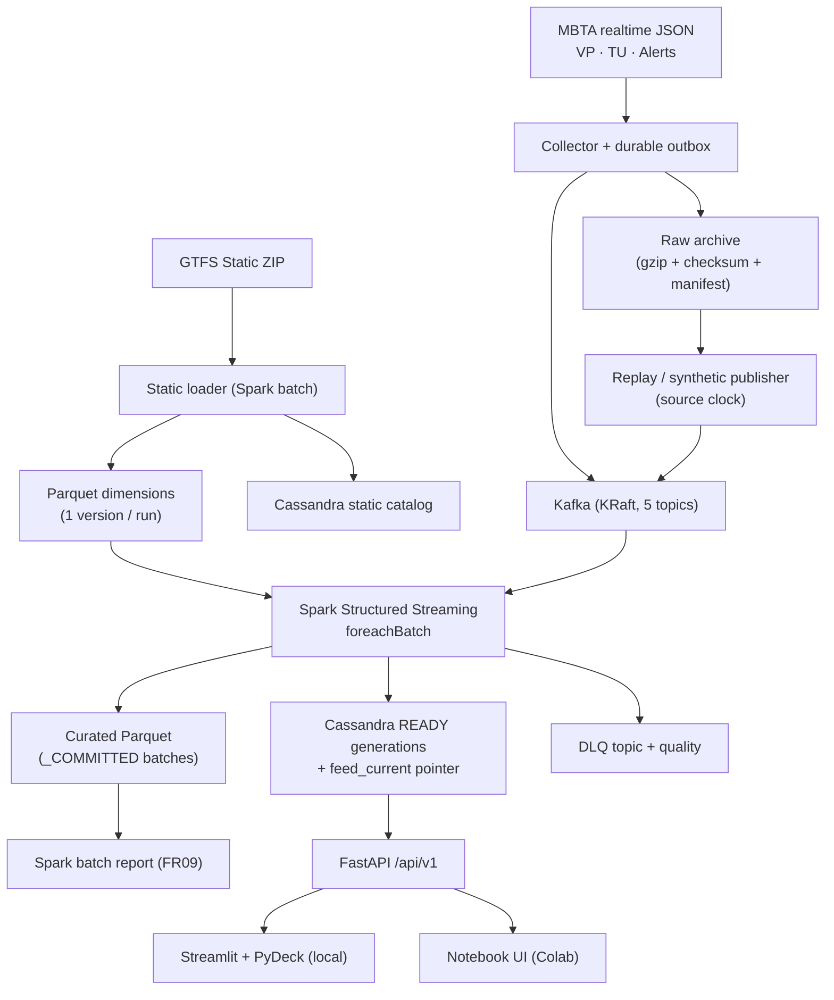

# Kiến trúc TransitPulse MBTA

## 1. Luồng dữ liệu (dùng chung cho hai profile)

| Đường | Luồng | Mục đích |
|---|---|---|
| Static | ZIP → version (SHA-256) → Spark batch validate → `dim_*` Parquet + bảng Cassandra static | Lịch, tuyến, trạm, shape theo một version bất biến |
| Realtime | JSON → raw + outbox → Kafka → Spark → Cassandra views + curated history | Vị trí, dự báo, cảnh báo |
| Application | Cassandra → FastAPI → Streamlit / notebook | Chỉ đọc dữ liệu đã xử lý |
| Replay | Recording + đúng GTFS version → publisher → cùng Kafka/Spark/API | Demo lặp lại, offline, benchmark |
| Quality | Lỗi parse/validation → DLQ (excerpt có giới hạn + raw reference) + `quality_by_snapshot` | Điều tra |
| Batch report | Curated Parquet → Spark batch (dedup, cửa sổ thời gian) → báo cáo | Phân tích lịch sử |

## 2. Trách nhiệm từng thành phần

| Thành phần | Làm | Không làm |
|---|---|---|
| Static loader (`static/`) | Version GTFS, validate, lọc scope, dims Parquet, catalog Cassandra, `scope_index.json` | Không đổi dims của run đang chạy |
| Collector (`ingestion/`) | Poll 30 s/feed, raw trước Kafka, lọc scope thô, envelope ≤ 4 MiB, outbox, status | Không tính KPI, không tạo empty snapshot khi lỗi |
| Publisher (`replay/`) | Phát recording theo timeline + clock tick, pause/resume/step, synthetic tất định | Không gọi HTTP MBTA |
| Kafka | Vận chuyển snapshot/control/DLQ, offsets, retention 6 h | Không phải nguồn sự thật lâu dài |
| Spark (`processing/`) | Parse, validate, explode, join GTFS, IDs, dedup, freshness, KPI, alerts, generation/pointer, curated | Không thay transformation bằng vòng lặp Python trên dữ liệu lớn |
| Cassandra (`storage/`) | Bảng theo query, manifest, pointer, history, quality, status | Không join, không ALLOW FILTERING, không counter |
| FastAPI (`api/`) | Đọc có giới hạn, tính freshness tại request, contract `{data, meta, warnings}`, lỗi có cấu trúc | Không đọc raw/Kafka/MBTA, không tính lại KPI |
| Streamlit / notebook UI | Chọn run/tuyến/trạm, hiển thị nguồn, thời gian, chất lượng | Không tính nghiệp vụ, không zero-fill |
| Native supervisor (`runtime/`) | Khởi động/dừng Kafka, Cassandra, processor, publisher, API với ownership | Không pkill/killall, không xóa dữ liệu khi stop |

## 3. Topics Kafka

| Topic | Nội dung | Key |
|---|---|---|
| `mbta.vehicle_positions.snapshots.v1` | Snapshot vị trí xe đã lọc scope | `run_id|vehicle_positions` |
| `mbta.trip_updates.snapshots.v1` | Snapshot dự báo chuyến | `run_id|trip_updates` |
| `mbta.alerts.snapshots.v1` | Snapshot cảnh báo | `run_id|alerts` |
| `mbta.control.v1` | Run lifecycle, clock tick, collector/publisher status | `run_id|control` |
| `mbta.dlq.v1` | Lỗi có reason, reference, excerpt ≤ 2 KiB | `run_id|feed_type` |

Một partition/topic, RF1, `max.message.bytes` 5 MiB (envelope ≤ 4 MiB + headroom), producer `acks=all` +
idempotence, consumer Spark `kafka.max.partition.fetch.bytes` 8 MiB, `failOnDataLoss=true`.

## 4. Hai profile chạy

| | `colab-native` / `local-native` | `local-docker` |
|---|---|---|
| Khởi chạy | Binary distributions + supervisor Python (không Docker/systemd/sudo) | Docker Compose |
| Python core | `.venv` Python 3.11.17 do uv quản lý, tách kernel notebook | image pin |
| Hạ tầng | Kafka 4.2.2 KRaft, Cassandra 5.0.9, Spark `local[2]` trong cùng VM | container cùng phiên bản |
| Frontend | Notebook UI qua HTTP (Colab), Streamlit tùy chọn | Streamlit |
| Trạng thái kiểm chứng | Chạy lần đầu trên Colab (`NOT_VERIFIED` khi bàn giao) | `NOT_RUN` (không có quyền Docker trên máy build) |

Hai profile dùng chung source code, schema, transformations, API và oracle; chỉ khác launcher, địa chỉ kết
nối, resource budget và root paths.

Chi tiết: `docs/publish_protocol.md` (generation/pointer), `docs/clock_and_time.md` (đồng hồ, lịch GTFS),
`docs/data_dictionary.md` (bảng và cột), `docs/query_mapping.md` (endpoint → bảng), `docs/runbook.md` (vận
hành), `docs/decisions.md` (quyết định).
