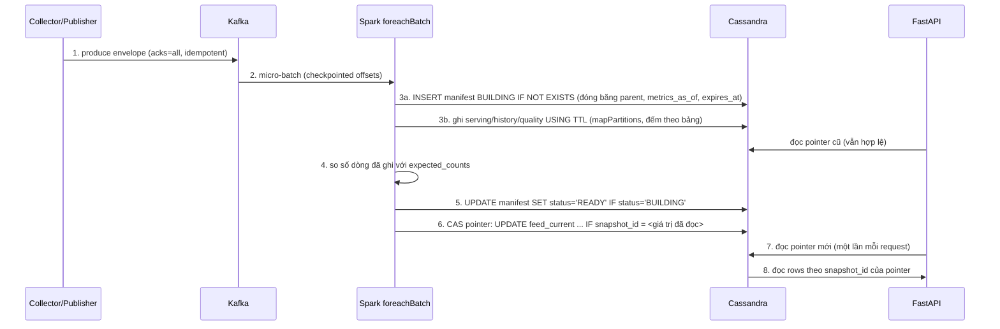

# Giao thức publish generation và phục hồi

Không có transaction xuyên Kafka, filesystem và Cassandra. TransitPulse kiểm soát **visibility** bằng
generation bất biến + manifest `READY` + con trỏ `feed_current` cập nhật bằng compare-and-set (LWT).
Bảo đảm của MVP: **at-least-once delivery với ghi và publish idempotent** — không phải exactly-once.

## 1. Thuật ngữ

| Thuật ngữ | Nghĩa |
|---|---|
| Snapshot | Trạng thái một feed đã lọc scope, một Kafka message (`snapshot_id` ổn định) |
| Generation | Bộ hàng phục vụ bất biến của một snapshot (`generation_id` 1:1 với snapshot trong một run) |
| Manifest | Hàng `snapshot_manifest`: `BUILDING` → `READY`, các tham số đóng băng, counts, lineage |
| Pointer | Hàng `feed_current(run_id, feed_type)`: generation mà API được phép đọc |
| `source_order` | Chuỗi `%012d.%017d.%s` = (feed timestamp, thời điểm capture gốc µs, snapshot_id); so sánh chuỗi = so tuple |

## 2. Trình tự (PDF trang 13)

## 3. Quy tắc

1. **Đóng băng ở lần build đầu.** `insert_building` dùng `INSERT ... IF NOT EXISTS`; nếu hàng đã tồn tại (retry
   hoặc writer khác), dùng đúng tham số đã lưu: `parent_snapshot_id`, `metrics_as_of`, `expires_at`,
   `history_expires_at`, `first_materialized_at`, `built_as_late`. Kết quả logic không phụ thuộc wall clock mới.
2. **Parent** = max(pointer hiện tại, snapshot không-trễ trước đó của cùng feed trong cùng micro-batch). Parent
   chỉ dùng để kế thừa có kiểm soát (vị trí khi `OBSERVATION_TIME_REGRESSION`, alert khi snapshot partial) và
   để phân loại duplicate observation; nó không bao giờ mang xe vắng mặt sang danh sách fresh.
3. **Ghi idempotent.** Mọi hàng có khóa xác định (`vehicle_id`, `observation_id`, `prediction_id`, `alert_id`,
   `reason_code`); ghi lại cùng hàng là no-op logic. Không dùng counter. TTL = số giây còn lại tới
   `expires_at` (serving) hoặc `history_expires_at` (history/quality); TTL < 1 → raise (TTL 0 nghĩa là vĩnh viễn).
4. **READY sau khi đủ.** Số dòng ghi được (trả về từ executor) phải bằng `expected_counts` theo bảng; lệch →
   batch fail, không READY, pointer giữ nguyên.
5. **CAS theo thứ tự nguồn.** Pointer chỉ tiến khi `source_order` mới lớn hơn. Pointer đã trỏ đúng snapshot →
   thành công idempotent. Pointer mới hơn → snapshot là *late*: lưu audit/history, ghi
   `LATE_SNAPSHOT_NOT_PUBLISHED`, không rollback. Còn < 60 s TTL → `EXPIRED_NOT_PUBLISHED`.
6. **Visibility latency** = `view_published_at − published_at` của lần publish thành công đầu tiên; ghi một lần
   (`IF publish_outcome = null`); duplicate có metric riêng, không tạo latency âm.
7. **Lỗi hạ tầng bắt buộc** (Cassandra không ghi được) → exception lan ra, micro-batch fail, checkpoint không
   commit; restart cùng checkpoint xử lý lại cùng `batch_id` với cùng offsets.

## 4. Kịch bản phục hồi

| Tình huống | Hành vi | Test |
|---|---|---|
| Cùng snapshot gửi lại | Manifest READY được tái sử dụng; không tăng counts/history | IT02 |
| Snapshot cũ đến sau snapshot mới | READY nhưng không thành current; pointer và tọa độ không lùi | IT03 |
| Crash sau ghi một phần, trước READY | API vẫn đọc generation cũ; retry hoàn tất cùng ID/parent | IT10 |
| Crash sau CAS, trước commit checkpoint | Retry thấy pointer đã đúng; không đổi `view_published_at`/`expires_at` | IT11 |
| Cassandra không ghi được | Batch fail, offsets không được coi là xử lý xong; sau phục hồi xử lý backlog | IT12 |
| Generation hết TTL | API trả 503 `generation_expired`; khác với snapshot rỗng hợp lệ (200, `[]`) | IT15 |
| Checkpoint mất offsets do Kafka retention | `failOnDataLoss=true` dừng query; hướng dẫn replay vào run mới | runbook |

Fault injection: arm file one-shot `<W>/faults/<run_id>/<point>.json` (`after_partial_write`,
`after_ready_before_cas`, `after_cas_before_commit`, `executor_write_error`), processor thoát với mã 86; chỉ có
hiệu lực khi processor chạy với `--enable-fault-injection`.

## 5. State machines (PDF trang 30)

* Run: `CREATED → RUNNING ⇄ PAUSED → FINISHED | FAILED`. Resume giữ `clock_sequence`; restart FAILED dùng lại
  run/checkpoint nếu input còn phục hồi được.
* Generation: `BUILDING → READY`; visibility chỉ đổi khi pointer được publish. Late READY có thể không bao giờ
  thành current. Expiry là trạng thái availability theo `expires_at`, không biến READY thành generation rỗng.
